# Comprendre le fonctionnement d’OptiMeal

Ce guide explique comment les écrans, le serveur, Supabase et les fichiers du dépôt travaillent ensemble. Il décrit le code relu au **20 novembre 2026**, notamment les parcours d’Accueil, de Promos, du Calendrier, des Listes et des produits suivis. Les confirmations fonctionnelles restent datées séparément.

Le parcours principal relie les recettes, les repas planifiés et les achats : choisir ses portions, regrouper les ingrédients, comparer les produits des magasins et suivre ses courses. Le [guide détaillé de Liste](backend/docs/SHOPPING_GUIDE.md) complète ce document avec les boutons, les parcours et les règles de calcul de cet onglet.

La présence d’une fonction dans le code ne prouve pas sa validation sur tous les appareils ni l’application de sa migration sur Supabase. Les confirmations connues sont distinguées des vérifications encore nécessaires. Les schémas Mermaid peuvent être consultés dans un aperçu Markdown compatible.

Le cadrage du **17 novembre 2026** retire les modes IA destinés aux utilisateurs, la gestion avancée du budget, l’historique stable des plans et des prix, les estimations statistiques et la contribution par reçu. Les montants calculés à partir du catalogue, l’historique des listes terminées et les outils locaux de lecture des reçus sont conservés. Les liens de création IA ont été retirés de Recettes. Le filtre Petit budget, représenté par $, classe les recettes selon le coût estimé des quantités utilisées, sans afficher ce montant.

## 1. Les grandes parties de l’application

Les offres peuvent inclure un prix promotionnel limité aux premières unités, avec un prix après limite. Les calculs des listes tiennent compte de ces conditions et de la date des courses. Un prix ou un format absent reste inconnu ; il n’est pas remplacé par une valeur inventée.

Le **frontend** est l’application mobile : il affiche les écrans et reçoit les actions de l’utilisateur. Le **backend** est le serveur : il répond aux demandes du mobile, vérifie les droits et lit ou enregistre les données.

Supabase fournit trois services utilisés par OptiMeal : **Auth** pour les comptes, **PostgreSQL** pour les données et **Storage** pour les images.

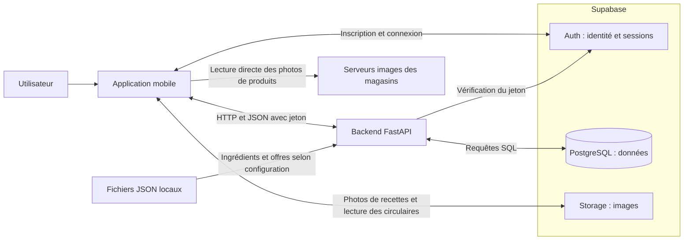

| Partie | Question à laquelle elle répond | Exemple |
| --- | --- | --- |
| Mobile React Native | Que voit et que fait l’utilisateur ? | Remplir le formulaire d’une recette |
| Supabase Auth | Qui est connecté ? | Fournir une session après connexion |
| FastAPI | La demande est-elle valide et autorisée ? | Vérifier que la recette appartient au compte |
| PostgreSQL | Quelles données conserver ou retrouver ? | Enregistrer la recette et ses ingrédients |
| Supabase Storage | Où conserver les fichiers images ? | Héberger les photos de plats et les pages des circulaires |
| JSON locaux | Quelles captures préparées sont disponibles ? | Fournir le catalogue commun des offres |

Le mobile contacte directement Auth et Storage. Pour les tables métier, comme les recettes et les profils, il passe par FastAPI. Les identifiants PostgreSQL restent côté serveur.

## 2. Où fonctionne chaque partie pendant le développement ?

Dans le montage local, l’application s’ouvre sur téléphone, simulateur, émulateur ou navigateur. Deux serveurs distincts fonctionnent sur l’ordinateur : Expo Metro fournit le code de développement et FastAPI répond aux demandes métier.

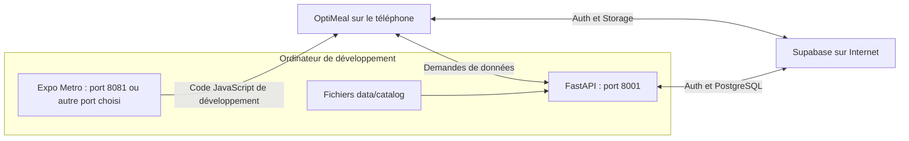

**Expo Metro fournit le code de développement au mobile. FastAPI fournit les données métier.** Le fichier `mobile/metro.config.js` configure le bundler Metro ; il n’a aucun lien avec l’épicerie Metro.

Sur un téléphone, `localhost` désigne le téléphone. L’URL du backend doit donc utiliser l’adresse locale de l’ordinateur, par exemple `http://192.168.1.20:8001`. Cette adresse est un exemple à remplacer. Le téléphone et l’ordinateur doivent pouvoir communiquer sur le réseau.

| Si un composant est arrêté | Conséquence dans ce montage |
| --- | --- |
| FastAPI | Les lectures et enregistrements métier échouent |
| Expo Metro | Le chargement ou l’actualisation du JavaScript de développement est interrompu |
| Accès Internet à Supabase | La connexion, les accès à la base distante et les photos sont affectés |
| Ordinateur | Les deux serveurs locaux deviennent indisponibles |

Pour une utilisation autonome, il faudra une version mobile contenant son code JavaScript et un backend hébergé à une adresse accessible. Le site GitHub Pages actuel héberge la documentation.

Sur iPhone, la signature de développement constitue une autre condition
d’ouverture : avec une Personal Team Apple gratuite, le profil expire après
7 jours. Un renouvellement et une réinstallation sont alors nécessaires,
indépendamment des serveurs. Le [guide mobile](mobile/README.md#iphone--renouveler-la-signature-du-compte-apple-gratuit)
donne la procédure et la commande `xcodebuild -allowProvisioningUpdates`
utilisée lorsqu’Expo ne peut pas générer le profil manquant.

## 3. Ouvrir l’application et se connecter

[mobile/App.tsx](mobile/App.tsx) contient la navigation et choisit ce qui doit être affiché selon la session. [AuthContext.tsx](mobile/context/AuthContext.tsx) partage l’état de connexion entre les écrans.

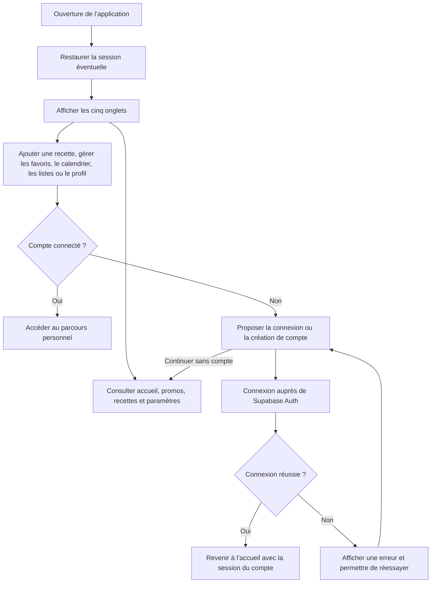

À l’inscription, l’utilisateur doit confirmer son courriel. Le retour dans l’application utilise le lien `optimeal://auth/callback` et un échange de code pour obtenir la session.

Les cinq onglets sont **Accueil, Promos, Recettes, Calendrier et Listes**. Le nom technique du dernier onglet reste `Liste` dans la navigation. Ils restent visibles en mode visiteur, mais les actions personnelles demandent une connexion. Calendrier est protégé par `AccountRequired` ; le navigateur Liste exige aussi une lecture privée réussie auprès du serveur avant de monter ses écrans.

Le client [services/supabase.ts](mobile/services/supabase.ts) configure Auth et conserve la session avec AsyncStorage. `AuthContext.tsx` restaure cette session, écoute ses changements et traite le retour du lien de confirmation. Une connexion, déconnexion ou un changement de compte recrée la navigation à l’accueil, afin de retirer les écrans du compte précédent.

La connexion s’ouvre dans une fenêtre. « Continuer sans compte » et le retour Android permettent de l’annuler sans enregistrer l’action personnelle. [AccountRequired.tsx](mobile/components/AccountRequired.tsx) protège aussi les écrans de création et d’édition ouverts directement. Le backend vérifie toujours les droits, même lorsqu’un bouton est masqué ou protégé dans le mobile.

### Accueil et menu du compte

[HomeScreen.tsx](mobile/app/HomeScreen.tsx) affiche la date, une salutation et un bouton **Mon compte** en haut à droite. Ce bouton ouvre [MenuCompte.tsx](mobile/components/MenuCompte.tsx), avec Mes listes, Produits suivis, Ingrédients non suggérés et Paramètres. Il remplace l’ancien accès direct par roue dentée.

Sans compte, l’accueil présente une invitation à découvrir les recettes, promotions et circulaires. Avec une session, il charge les repas de la semaine et de la suivante, la première page des listes, les offres et les produits suivis.

| Zone | Comportement actuel |
| --- | --- |
| Aujourd’hui / Demain | Repas du jour ; à partir de 21 h, présentation de ceux du lendemain. Les horaires sont ceux de l’appareil. Une recette accessible ouvre sa fiche dans la pile Accueil. |
| Mes listes en cours | Jusqu’à trois listes actives ou brouillons, par modification récente, sans masquage lié à la date technique des prix. Voir toutes ouvre Liste ; toucher une ligne ouvre son détail. |
| Promos suivies | Jusqu’à huit offres actives correspondant aux produits suivis ; accès au détail, aux suivis et aux promotions. |

Les lignes de listes d’Accueil et de Liste partagent le même résumé : reste à acheter et magasins illustrés par des icônes puis **Total estimé** ou **Sous-total connu** uniquement lorsqu’un produit chiffré a été retenu ou acheté. Une liste d’articles n’affiche pas de montant ; les produits présentent leur montant à droite sous Total estimé ou Sous-total connu, avec le symbole $ après le montant, sans icône monétaire supplémentaire. Le budget connu inclut les achats enregistrés. L’accueil filtre encore la première page reçue ; une liste masquée reste accessible dans Liste.

**Créer la liste de la semaine** transmet le lundi et le dimanche de la semaine courante au parcours calendrier. Sans repas planifié, **Créer une liste** propose Articles ou Produits avant de créer la liste vide persistante. L’épinglage est conservé en base et dans le menu d’une liste, mais cet Accueil ne l’utilise pas pour choisir ses lignes.

### Paramètres

[ProfileScreen.tsx](mobile/app/ProfileScreen.tsx) affiche une carte de compte avec nom et courriel, puis les sections **Nom affiché** et **Session**. Le profil est relu à chaque ouverture. Le bouton Enregistrer apparaît lorsque le nom change ; une sauvegarde réussie affiche brièvement « ✓ Enregistré ». La section Session propose déconnexion et suppression du compte.

En mode visiteur, Paramètres propose la connexion sans demander le profil privé à l’API. Le retour ramène vers Accueil. Les préférences alimentaires ou recommandations avancées ne sont pas implémentées par cet écran.

### Données conservées sur le téléphone

Les listes et leurs achats sont sauvegardés sur le serveur. Le mobile ne conserve plus de cache complet des listes ni de file de synchronisation hors connexion. Il conserve, par compte, les commandes dont la réponse reste incertaine pour permettre une reprise manuelle avec la même clé.

Les produits suivis ont un stockage local par compte et une persistance serveur complémentaire, décrits dans la section Promos. Les trois ajouts récents proposés par la recherche des listes sont aussi conservés par compte, après un ajout réussi ; les références de produits y sont gardées sans prix. Le choix grille/liste de Promos est une préférence locale d’affichage. Les anciennes clés de l’ancien moteur de listes restent inutilisées, sans parcours d’import proposé à l’utilisateur.

Une panne ne devient pas un faux état vide réussi. Les écrans signalent les erreurs, conservent la saisie lorsque possible et proposent une reprise. Les réponses tardives d’un écran ou d’un ancien compte sont ignorées par les contrôles d’identité des parcours concernés.

### Identité des produits

Les suivis et les choix manuels utilisent `product_id`, l’identité stable d’un produit pour une enseigne et un magasin. `offer.id` désigne le relevé exposé par l’API et peut changer avec ses données. Les anciens suivis fondés sur l’offre sont rapprochés du produit lorsque l’offre est identifiable ; sinon ils restent signalés comme suivis à réassocier.

### Supprimer son compte depuis Paramètres

L’utilisateur connecté peut choisir « Supprimer mon compte », saisir
`SUPPRIMER` et confirmer. Le mobile envoie `DELETE /api/v1/me` avec son jeton ;
il ne choisit jamais librement l’identifiant du compte à supprimer.

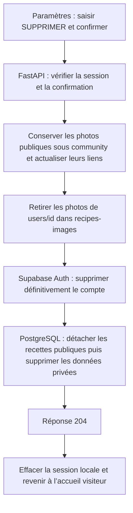

[accounts/deletion.py](backend/app/accounts/deletion.py) appelle Storage et
Auth avec la clé serveur `SUPABASE_SECRET_KEY`. Les recettes publiques restent
accessibles sans lien avec le compte supprimé : la migration `0015` détache
leur propriétaire avant la suppression du profil. Leurs ingrédients, évaluations
par les autres comptes, favoris et références dans les calendriers sont conservés.
Les photos publiques du dossier personnel sont d’abord copiées dans `community/`
avec une clé serveur, et leurs liens sont actualisés avant le nettoyage des originaux.
Le profil, les recettes privées, les favoris, les repas, les évaluations, les listes et les préférences privées liées au profil sont retirés par leurs cascades. Les produits suivis en base sont également liés au profil avec suppression en cascade. Les autres comptes et les circulaires sont conservés.
La suppression bloque les créations et modifications de recettes du compte
pendant son traitement. En cas d’échec, il faut relancer la suppression depuis
Paramètres ; aucune photo publique source n’est effacée avant la sauvegarde
de sa copie. Storage et Auth ne partagent pas de transaction. Les nouveaux
parcours sont couverts par des tests locaux avec fournisseurs simulés ; les
derniers ajustements sont confirmés globalement sur téléphone le 5 novembre,
sans résultat individuel pour chaque scénario de suppression. Voir le [guide Auth](backend/docs/AUTH.md#suppression-définitive-du-compte).

### À quoi sert le jeton ?

Supabase Auth délivre un **jeton d’accès**, aussi appelé JWT. Le mobile le joint aux appels FastAPI dans l’en-tête `Authorization: Bearer …`.

[backend/app/security.py](backend/app/security.py) vérifie ce jeton auprès de Supabase Auth, via `/auth/v1/user`, puis obtient l’identité du compte. Les services métier utilisent cette identité pour contrôler les droits. Si FastAPI répond 401 à un compte connecté, le client `api.ts` tente une fois de renouveler la session avant de reprendre la requête. Les autres erreurs sont remontées à l’écran ; le délai réseau est de 15 secondes par défaut.

Par exemple, être connecté avec le compte B ne donne pas le droit de modifier une recette du compte A. Masquer un bouton dans l’écran améliore l’interface ; le contrôle décisif se fait aussi dans le backend.

## 4. Consulter les recettes : le trajet complet

Une **API** est une interface entre programmes. Ici, le mobile envoie une requête HTTP à FastAPI et reçoit du JSON, un format de données structuré.

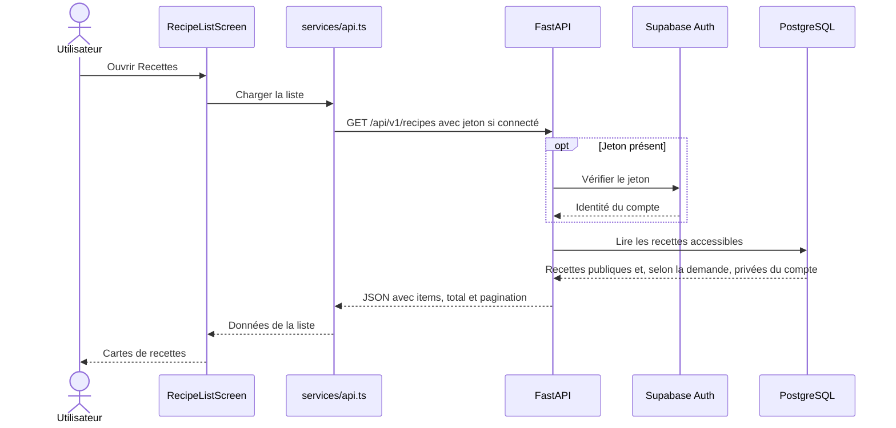

Le fichier [RecipeListScreen.tsx](mobile/app/RecipeListScreen.tsx) demande la liste et affiche les états de chargement, d’erreur ou de résultat vide. Il transmet la recherche et les filtres au serveur :

| Action | Requête correspondante |
| --- | --- |
| Découvrir | `GET /api/v1/recipes?scope=discover` |
| Mes recettes | `GET /api/v1/recipes?scope=mine` |
| Chercher « poulet » dans Découvrir | `GET /api/v1/recipes?scope=discover&q=poulet` |
| Voir ses recettes rapides | `GET /api/v1/recipes?scope=mine&quick=true` |
| Voir ses favoris | `GET /api/v1/recipes?scope=favorites` |
| Lire une recette complète | `GET /api/v1/recipes/{id}` |

Rapides signifie **une durée totale enregistrée de 30 minutes au maximum**. Pour les recettes saisies avec le formulaire actuel, cette durée est la somme des durées des étapes. Petit budget classe les recettes du moins cher au plus cher selon les ingrédients chiffrables en base, sans afficher de prix.

Sans jeton, l’API permet de lire les recettes initiales et les recettes publiées par les utilisateurs. Avec une identité valide, elle ajoute les recettes privées de ce compte. Le mobile permet également cette consultation sans compte. Ajouter une recette, consulter ou modifier ses favoris et accéder au profil demande une connexion.

Le mobile propose trois sections : Découvrir (`scope=discover`, recettes
publiques), Mes recettes (`scope=mine`, créations du compte) et Favoris
(`scope=favorites`, favoris accessibles). Découvrir est sélectionnée au départ.
Les deux autres sections demandent une connexion. Recherche et filtres Toutes,
Rapides, Faciles et Petit budget restent dans la section active ; changer de section
réinitialise la pagination. Les cartes indiquent Par vous, Par OptiMeal ou
Par la communauté. Mes recettes affiche aussi le statut Privée/Publique.
Le filtre Faciles demande au serveur les recettes dont la moyenne du critère
Facilité atteint au moins 4/5 pour la version courante. Les recettes sans
évaluation courante sont exclues. Ce filtre s’applique avant le comptage et
la pagination, dans la section choisie et avec la recherche active.
Les cartes affichent la durée, les portions et les nombres d’ingrédients et
d’étapes avec des icônes. Ces compteurs viennent directement de la liste API,
sans charger le détail de chaque recette. La note globale et le nombre d’avis
figurent en bas à droite, avec une étoile et le format « 4,5 (28) », ou
« Non notée ». L’auteur et la visibilité dans Mes recettes sont à gauche ;
le cœur en haut à droite de la photo permet d’ajouter ou retirer un favori
sans ouvrir la recette. Il est en contour ou plein selon l’état confirmé et
affiche un indicateur pendant l’enregistrement. Une erreur conserve la carte
et son état ; sans compte, cette action propose la connexion. Dans Favoris,
un retrait confirmé recharge les résultats et leur compteur. Le reste de
la carte ouvre le détail.
Découvrir et Favoris proposent Mieux notées (par
défaut) et Plus récentes ; Mes recettes affiche les créations de la plus récente
à la plus ancienne, sans choix de tri. Le tri est conservé par section et au retour du
détail. Le changer ramène à la première page sans effacer recherche et filtres.
Le serveur trie tous les résultats accessibles avant la pagination. Mieux
notées tient compte du nombre de votes, sans remplacer la moyenne affichée
par le score de classement.

**Petit budget** remplace temporairement le tri habituel dans Découvrir,
Mes recettes et Favoris. Le serveur additionne les coûts des quantités utilisées
pour la recette entière, en retenant le produit compatible le moins cher par
ingrédient dans PostgreSQL. Par exemple, 100 g d'un sac de 1 kg à 5 $ comptent
pour 0,50 $, sans arrondir à un sac entier. Les promotions actives et leurs
limites sont prises en compte. Les ingrédients sans prix ou format compatible
sont ignorés ; sans aucun ingrédient chiffrable, la recette est placée à la fin.
Le classement porte sur tous les résultats avant pagination et conserve la
recherche. Aucun montant n'est envoyé au mobile ni affiché. Le coût n'est stocké
dans aucune table ou colonne et n'est pas calculé à la sauvegarde d'une recette :
il est estimé au prochain chargement de Petit budget. Les quantités viennent de
`recipe_ingredient` ; les prix et formats viennent de `product_offer`.

Pour chaque produit compatible : **coût = quantité utilisée ÷ quantité du
produit × prix applicable**, après conversion dans la même unité. Le coût
interne de la recette est la somme des coûts minimaux des ingrédients chiffrables,
pour toutes ses portions de référence. Les règles complètes, dont les promotions
limitées, figurent dans les [contrats](backend/docs/CONTRACTS.md#petit-budget).

Les coûts sont recalculés à chaque requête depuis les prix en base, même si
Promos utilise le JSON. Après l'import hebdomadaire, habituellement le mercredi,
le prochain chargement reflète les nouveaux prix. Une modification des quantités
d'une recette est également prise en compte. Aucun coût stocké ni migration
supplémentaire n'est nécessaire. Une estimation partielle peut sous-estimer le
coût réel ; ce tri ne garantit pas le prix d'un panier complet.

Une section vide propose une action adaptée : créer sa première recette,
découvrir des recettes ou effacer la recherche et les filtres. Sans paramètre
de section, le backend conserve la collection accessible pour les autres consommateurs. La création
accepte `visibility`, privée par défaut ; le propriétaire peut ensuite envoyer
`PATCH /api/v1/recipes/{id}/visibility` avec `public` pour publier ; le retour
au privé d’une recette publique est refusé. Une ancienne
modification de contenu ne change pas la visibilité. Le formulaire propose un interrupteur de partage, désactivé par défaut à la création, et charge le statut courant en édition. Le détail permet au propriétaire de publier définitivement sa recette après confirmation. Une recette publique ne peut plus être supprimée ni rendue privée. Le même bucket public de photos
est conservé pendant le prototype ; sa séparation privé/public est reportée après
le prototype. Publier une recette conserve le fichier et son URL. La suppression du compte copie ensuite les photos publiques vers un dossier serveur avant le nettoyage du dossier personnel.
Les règles détaillées sont dans les [contrats](backend/docs/CONTRACTS.md).

## 5. Créer une recette et enregistrer sa photo

Le bouton **+** dans un cercle, en haut à droite du titre **Recettes**, ouvre directement le formulaire manuel pour un compte connecté. En mode visiteur, il propose la connexion. Les liens Trouver une idée, Cuisiner avec ce que j’ai et Structurer mon idée sont retirés ; les modes IA ont été retirés du périmètre le 17 novembre.

La création présente une page à la fois, avec **Étape X sur 5**, une progression segmentée et les boutons **Précédent / Continuer**.

| Étape | Contenu et validation |
| --- | --- |
| 1. Présentation | Nom, photo et portions. Les besoins de nom et de photo sont signalés en rouge ; les portions sont un entier positif. |
| 2. Ingrédients | Choix des ingrédients, quantités positives, unités et précisions facultatives. |
| 3. Préparation | Instructions, durée entière de chaque étape et total automatique. |
| 4. Informations | Étiquettes et autres informations facultatives, dont la description. |
| 5. Visibilité | Résumé, choix privé/public et enregistrement final. Privée par défaut ; publication après confirmation. |

Chaque bouton Continuer vérifie uniquement la page active. Précédent, la flèche du titre et le retour Android permettent de reculer sans perdre les saisies. La photo reste locale jusqu’à l’enregistrement final. Quitter une création commencée demande confirmation ; les saisies sont conservées en mémoire pendant le parcours, sans brouillon persistant après fermeture de l’application. L’édition d’une recette existante conserve son formulaire prérempli sur une seule page.


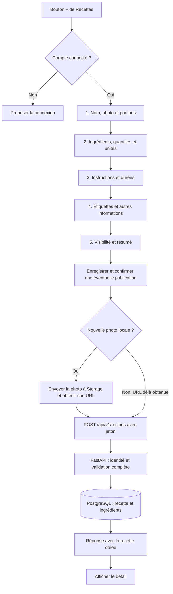


Les responsabilités se répartissent ainsi :

1. Le formulaire recueille le nom, les portions, les ingrédients, les étapes et les étiquettes. Chaque étape demande une durée entière en minutes, 0 étant accepté pour une étape immédiate. Le total affiché est la somme de ces durées ; les champs de préparation et de cuisson séparés sont retirés. Le nom est obligatoire : le bouton d’enregistrement reste désactivé s’il est vide ou ne contient que des espaces. À la création, une photo est également obligatoire ; les autres champs requis sont vérifiés avant l’enregistrement. L’auteur ne choisit plus la difficulté : les autres utilisateurs évaluent la facilité avec le critère « Facilité ». L’ancienne difficulté n’est plus affichée dans le détail.
2. `IngredientPicker.tsx` aide à choisir un ingrédient du référentiel commun. La quantité se saisit dans un champ numérique séparé ; l’unité se choisit dans un sélecteur compact ouvrant une liste en bas de l’écran : g, ml, unité, tasse (250 ml), cuillère à table (15 ml) et cuillère à thé (5 ml). Le choix courant porte une coche ; fermer la liste sans sélection conserve la valeur. Aucune unité n’est présélectionnée pour un nouvel ingrédient. Les quantités doivent être positives ; seules les pièces exigent un entier. Une demi-tasse se saisit avec `0,5`. L’unité choisie est conservée et affichée dans le détail. La migration `0014_recipe_kitchen_units` doit être appliquée avant d’enregistrer les nouvelles unités. `recipeForm.ts` regroupe ces validations et les règles des badges.
3. La photo, obligatoire pour créer une recette, est préparée par `recipeImages.ts` : JPEG, côté maximal de 1 200 pixels et limite de 5 Mo. Son envoi intervient à l’enregistrement.
4. `api.ts` transmet le formulaire à FastAPI avec le jeton.
5. Le backend exige une URL de photo HTTPS valide à la création, valide les autres champs et vérifie que les ingrédients existent en base. Il déduit le propriétaire de l’identité authentifiée.
6. Le backend recalcule la somme des durées des étapes. Les anciennes recettes conservent leur total en consultation ; en modification, leurs durées manquantes doivent être renseignées sans répartition automatique. Les durées sont conservées dans le JSON des étapes, sans migration. Les cartes, le détail et Rapides utilisent le total enregistré. Changer une durée d’étape ouvre une nouvelle version évaluée, même si le total reste identique. Les essais sur appareil de cet ajout restent à effectuer.
7. Le service enregistre la recette et ses liens vers les ingrédients dans une transaction PostgreSQL, puis renvoie le résultat.

**L’image et la recette sont enregistrées dans deux services différents.** Storage reçoit le fichier ; PostgreSQL conserve son URL dans `recipe.image_url`. Si l’envoi de l’image réussit mais que la recette ne peut pas être enregistrée, un fichier inutilisé peut rester dans Storage.

Les photos du bucket `recipes-images` sont publiques dans ce prototype. Les politiques Storage limitent les écritures à `users/<identifiant du compte>/`. En édition, retirer une photo enregistre `image_url: null` ; le fichier n’est pas automatiquement supprimé. Cette politique publique concerne les photos de recettes. Les reçus restent des fichiers locaux ; aucun parcours mobile de contribution n’est intégré.

La lecture de la photo préparée dépend de l’appareil : sur iOS et Android, `recipeImages.ts` utilise `File` de `expo-file-system` ; dans le navigateur, il lit l’URL locale `blob:` avec `fetch` puis `arrayBuffer()`. L’aperçu, la limite de 5 Mo, l’authentification et l’envoi final vers Storage restent soumis aux mêmes règles. La correction Web a été confirmée lors d’un essai sur ordinateur le 20 novembre ; elle ne constitue pas un nouvel essai natif. Le [guide des photos](backend/docs/RECIPE_IMAGES.md#lecture-sur-téléphone-et-navigateur) décrit les deux chemins.

### Choisir la visibilité et publier définitivement

Une recette est privée par défaut. Le réglage « Partager avec la communauté »
prépare sa publication ; Enregistrer demande une confirmation qui explique
qu’elle est définitive. Annuler n’envoie ni photo ni recette.
Une fois publique, la recette ne peut plus être rendue privée ni supprimée.
Elle reste dans Découvrir et accessible depuis les calendriers où elle a été
ajoutée, même si son auteur supprime son compte.

Le propriétaire peut encore modifier le contenu d’une recette publique.
En édition d’une recette privée, le contenu est enregistré par PUT avant
la publication par PATCH. Si la publication échoue, le formulaire précise que
le contenu a été enregistré et permet de réessayer. Une recette déjà publique
n’affiche plus d’interrupteur de partage ni de bouton Supprimer ou Rendre privée.
Le serveur refuse également ces opérations avec `409 PUBLIC_RECIPE_PERMANENT`.

### Modifier, supprimer et mettre en favori

| Demande | Route | Règle principale |
| --- | --- | --- |
| Créer | `POST /api/v1/recipes` | Associer au compte authentifié |
| Modifier | `PUT /api/v1/recipes/{id}` | Vérifier le propriétaire |
| Supprimer | `DELETE /api/v1/recipes/{id}` | Propriétaire ; recette privée uniquement |
| Publier | `PATCH /api/v1/recipes/{id}/visibility` | Propriétaire ; publication définitive, recettes initiales exclues |
| Ajouter un favori | `PUT /api/v1/recipes/{id}/favorite` | La recette doit être accessible au compte |
| Retirer un favori | `DELETE /api/v1/recipes/{id}/favorite` | Retirer seulement le favori de ce compte |

Les recettes initiales restent communes et ne peuvent pas être modifiées par les utilisateurs. Les favoris sont personnels, y compris lorsqu’ils concernent une recette initiale.

## 6. Pourquoi le backend contient plusieurs fichiers par domaine

Le backend est une seule application FastAPI, organisée par domaines. Cette séparation permet de retrouver une règle sans parcourir tout le serveur.

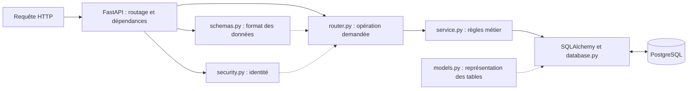

Ce schéma présente les responsabilités. La validation et les dépendances sont exécutées par FastAPI avant l’appel au traitement de la route ; les fichiers ne forment pas une suite d’étapes exécutées ligne par ligne.

| Fichier | Utilité et lien avec les autres |
| --- | --- |
| [main.py](backend/app/main.py) | Crée l’application, ajoute les routeurs et initialise les ressources au démarrage |
| [config.py](backend/app/config.py) | Lit les paramètres, notamment depuis `backend/.env` et l’environnement |
| [security.py](backend/app/security.py) | Fournit l’identité vérifiée aux routes protégées |
| [database.py](backend/app/database.py) | Configure le moteur PostgreSQL et fournit une session SQLAlchemy par requête |
| [recipes/router.py](backend/app/recipes/router.py) | Associe les routes HTTP aux opérations sur les recettes |
| [recipes/schemas.py](backend/app/recipes/schemas.py) | Définit les champs acceptés et retournés, avec leur validation |
| [recipes/service.py](backend/app/recipes/service.py) | Applique la visibilité, les contrôles de propriétaire, les écritures et les favoris |
| [recipes/budget.py](backend/app/recipes/budget.py) | Calcule le coût interne à partir des quantités utilisées et des prix en base pour Petit budget |
| [recipes/models.py](backend/app/recipes/models.py) | Représente les tables `recipe`, `recipe_ingredient` et `favorite` |
| [accounts/router.py](backend/app/accounts/router.py) | Expose l’identité et la lecture/modification du profil minimal |
| [accounts/service.py](backend/app/accounts/service.py) | Assure notamment la création du profil applicatif si nécessaire |

**SQLAlchemy** permet de construire les requêtes et de manipuler les données depuis Python. **Psycopg** est le pilote qui communique avec PostgreSQL. **Pydantic** valide les formats échangés par l’API. Ces outils remplissent des rôles complémentaires.

## 7. Quelles données sont conservées dans Supabase ?

Auth gère les comptes dans son propre schéma. Les tables applicatives décrivent ensuite les profils, les recettes et leurs relations.

### Schéma relationnel de la base

Ce schéma présente les tables principales des comptes, recettes, repas, suivis et offres. Le stockage des listes est décrit séparément ci-dessous. Les liens
représentent les clés étrangères vérifiées dans les modèles du backend.
`auth.users` appartient à Supabase Auth ; les autres tables figurent dans le
schéma `public`.

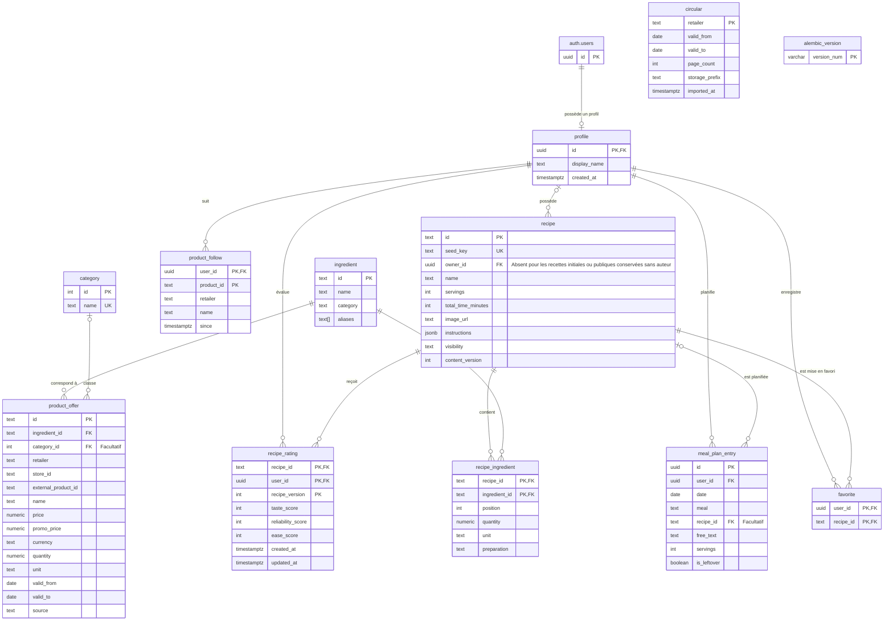

**Lire le schéma :** `PK` désigne une clé primaire, `FK` une clé étrangère
et `UK` une valeur unique. Plusieurs champs marqués `PK` dans une même table
forment ensemble sa clé primaire. Aux extrémités des liens, `||` signifie
exactement un, `o|` ou `|o` zéro ou un, et `o{` zéro à plusieurs.
Les champs affichés ne constituent pas la liste complète des colonnes ; les
champs facultatifs ne sont signalés ici que lorsqu’ils expliquent une relation.

| Table | Rôle dans l’application |
| --- | --- |
| `auth.users` | Identité et connexion, gérées par Supabase Auth |
| `profile` | Profil applicatif portant le même identifiant que le compte Auth |
| `recipe` | Contenu de la recette, portions de référence, visibilité et version évaluée |
| `recipe_ingredient` | Association recette–ingrédient avec quantité, unité et ordre d’affichage |
| `ingredient` | Référentiel commun utilisé pour relier recettes et produits des magasins |
| `favorite` | Association personnelle entre un compte et une recette |
| `meal_plan_entry` | Repas d’un compte à une date et un créneau, avec recette ou note libre |
| `recipe_rating` | Trois notes d’un compte pour une version du contenu d’une recette |
| `product_follow` | Produit suivi par un compte, indépendant du relevé de prix courant |
| `category` | Catégories des offres, comme les rayons alimentaires |
| `product_offer` | Produit d’un magasin avec format, prix relevés et période de validité |
| `circular` | Circulaire courante d’une enseigne et emplacement de ses pages dans Storage |
| `alembic_version` | Révision du schéma appliquée par Alembic |

Par exemple, une recette demandant 300 g de riz possède une ligne
`recipe_ingredient` qui référence l’ingrédient riz et conserve `quantity = 300`
et `unit = g`. Les fiches Maxi, Metro et Super C correspondantes référencent
ce même ingrédient dans `product_offer`. Ce lien permet de retrouver les
produits associés. Le moteur de Liste calcule les produits entiers à acheter selon les quantités et formats compatibles.

La clé de `recipe_rating` combine recette, compte et version : les votes des
anciennes versions restent enregistrés. `recipe_version` est comparé à
`recipe.content_version` par les services ; il ne constitue pas une clé
étrangère vers une table d’anciennes recettes.

`circular` et `alembic_version` n’ont pas de clé étrangère vers les autres
tables. Le champ `retailer`, présent dans les offres et les circulaires,
n’établit pas de relation SQL entre elles. De même, `ingredient.category`
est un texte ; seule `product_offer.category_id` référence la table `category`.

### Recettes, comptes et fichiers images

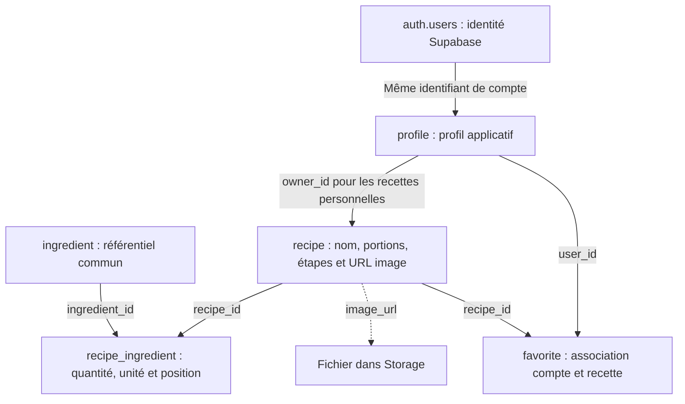

Une recette contient plusieurs lignes `recipe_ingredient`. Chaque ligne relie la recette à un ingrédient et porte la quantité nécessaire. Un même ingrédient peut ainsi servir dans plusieurs recettes.

Les étapes sont conservées dans un champ JSON de `recipe`. Le lien `image_url` est une URL de fichier ; ce n’est pas une clé étrangère PostgreSQL vers Storage.

Pour les recettes publiques conservées après suppression du compte, `owner_id` et `seed_key` sont nuls. Pour les recettes initiales, `owner_id` est nul et `seed_key` identifie la recette importée. Pour une recette personnelle, `owner_id` référence le profil du propriétaire.

Le catalogue et les circulaires disposent aussi de tables :

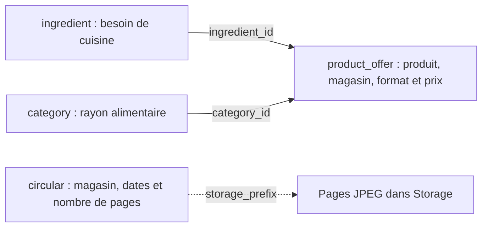

`product_offer` conserve le prix de base, le prix promotionnel éventuel, les dates, la source et, depuis la migration `0007`, le lien de la photo du produit et sa provenance (`image_url`, `image_source`). Un nouvel import actualise le produit de même identifiant ; cette table conserve les valeurs courantes, sans historique des prix. `circular` garde une seule circulaire par magasin et les informations nécessaires pour retrouver ses images dans le bucket public `circulars`.

### Ingrédient et produit commercial : quelle différence ?

Un ingrédient décrit un besoin de cuisine, par exemple une tomate fraîche. Un produit décrit ce qu’un magasin vend, avec son format, sa source et son prix relevé.

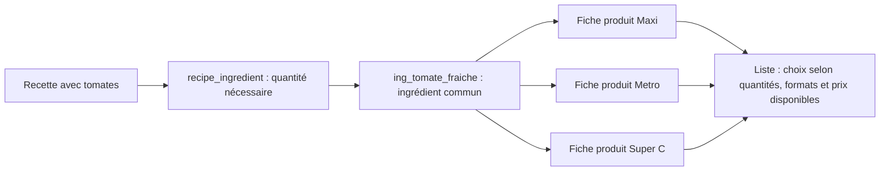

Le référentiel commun contient **31 ingrédients et 93 fiches produits**. Les clés `ing_…` permettent aux recettes et au catalogue de désigner le même ingrédient. Les identifiants propres aux magasins ne suffisent pas : un même numéro peut désigner deux aliments différents selon la source.

Les correspondances sont explicites et restent à vérifier selon les produits. Relier deux fiches à un ingrédient commun ne prouve pas que leurs formats ou leurs qualités sont interchangeables.

### Données privées des listes

Les tables de listes séparent les besoins des achats et des prix sauvegardés :

| Ensemble | Utilité |
| --- | --- |
| `shopping_list`, `shopping_list_item` | Nom, propriétaire, statut, dates et articles |
| `shopping_list_quantity`, `shopping_list_contribution` | Quantités requises ou possédées et provenance des recettes |
| `shopping_list_purchase`, `shopping_list_purchase_quantity` | Achats déclarés sans prix |
| `shopping_list_comparison`, `shopping_list_assignment`, `shopping_list_choice` | Résultats de calcul, panier choisi et préférences explicites de produits |
| `shopping_list_product_purchase` | Produits achetés, quantités, prix sauvegardés et allocations aux besoins |
| `shopping_list_template`, `shopping_list_exclusion`, `shopping_list_pin` | Modèles, ingrédients non suggérés et préférence d’épinglage |
| Tables de commandes et `shopping_list_revision` | Rejeu des écritures et état courant avec contrôle de révision |

Le schéma suivant présente les rôles des données, sans détailler toutes les clés étrangères :

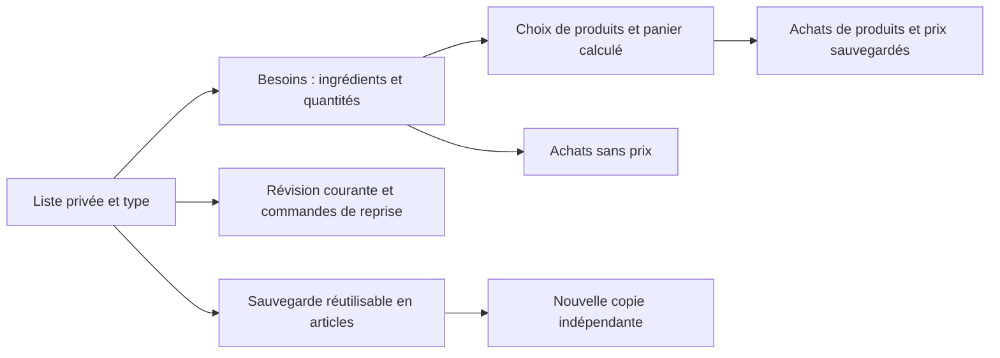

`shopping_list.kind` distingue les nouvelles listes d’articles et de produits. Les anciennes listes sans type restent lisibles, y compris lorsqu’elles mélangent les deux. La sauvegarde réutilisable et la liste de courses ont des identifiants et des achats séparés.

Le compteur de révision refuse les modifications concurrentes d’un état ancien. Il ne donne pas accès à un historique de versions. À chaque mutation, le service remplace l’instantané courant de la liste ; les résultats de commandes restent disponibles pour répondre sans doublon à une reprise.

`product_follow` possède une clé composée compte/produit, sans clé étrangère vers `product_offer` : un suivi peut ainsi rester enregistré lorsque le catalogue est actualisé ou qu’un produit en disparaît.

## 8. Pourquoi certaines routes lisent encore des JSON

Le raccordement à PostgreSQL avance par étapes. Le référentiel des ingrédients existe déjà en base pour les relations des recettes, mais sa route HTTP lit encore le catalogue JSON commun.

| Données ou route | Source utilisée actuellement |
| --- | --- |
| `/api/v1/recipes` et détail | PostgreSQL, relu à chaque requête |
| Profil et favoris | PostgreSQL |
| `/api/v1/plans`, listes, modèles, exclusions et épinglage | PostgreSQL |
| `/api/v1/follows` | PostgreSQL ; le mobile garde aussi ses suivis locaux |
| `/api/v1/ingredients` | Catalogue JSON commun chargé au démarrage |
| `/api/v1/offers` et détail | JSON par défaut, ou PostgreSQL avec `OFFERS_SOURCE=database` |
| `/api/v1/circulars` | PostgreSQL pour les informations ; Storage pour les images des pages |
| `/catalog` et `/catalog/offers` | Ancien export choisi avec `CATALOG_IMPORT_PATH` |
| Photos de recettes et pages des circulaires | Supabase Storage |
| Photos des produits | Serveurs images des magasins ; l’API transmet leur URL |

[common/public_data.py](backend/app/common/public_data.py) prépare les données exposées depuis le JSON ou les offres en base. [common/public_router.py](backend/app/common/public_router.py) fournit les routes des ingrédients, des offres et des circulaires.

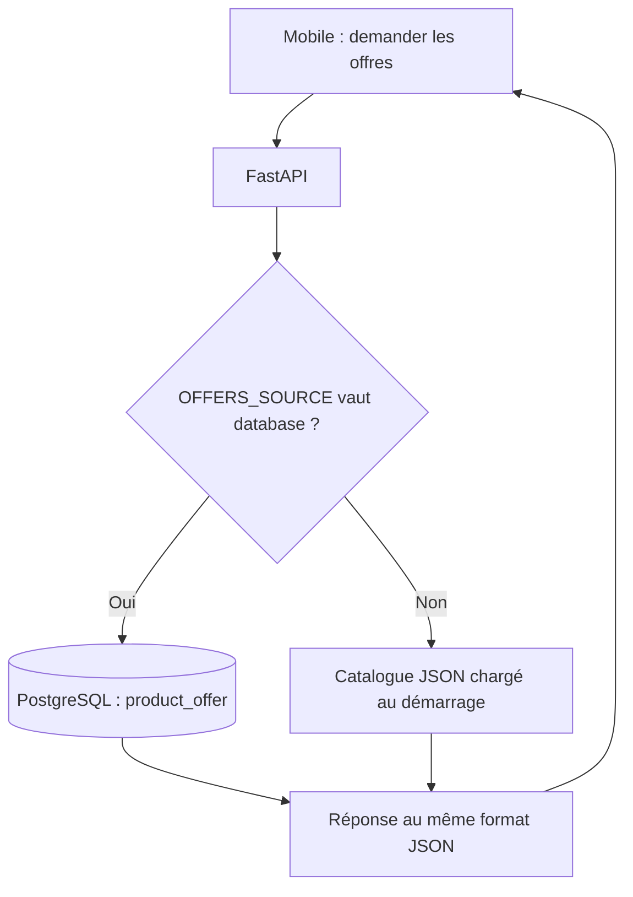

Le choix de source se fait au démarrage du serveur. Le mobile utilise la même route dans les deux cas. Les offres sont évaluées à la date du jour à Toronto, ou à la date fournie avec `on_date`. `promotion_only=true` conserve uniquement les promotions déclarées dont les dates permettent de confirmer qu’elles sont actives.

Le fichier commun par défaut est [data/catalog/baseCommune/ingredients.json](data/catalog/baseCommune/ingredients.json). Modifier ce fichier demande un redémarrage du serveur pour ses lectures HTTP. Modifier le JSON des recettes initiales ne change pas directement les recettes déjà en base : celles-ci passent par une commande d’import explicite.

Une panne PostgreSQL produit une erreur sur les routes qui en dépendent : recettes, profils, circulaires et offres lorsque la source choisie est la base. Elles ne basculent pas silencieusement sur une copie JSON. Le catalogue commun reste nécessaire, notamment pour vérifier les identifiants d’ingrédients dans la liste des offres. `/health` indique que le serveur répond ; `/health/db` vérifie la connexion par `SELECT 1`, sans garantir la présence de toutes les tables.

### Consulter les promotions

[PromotionsScreen.tsx](mobile/app/PromotionsScreen.tsx) utilise [search.ts](mobile/components/search.ts) pour charger **toutes les pages** de `/api/v1/offers`, cent offres à la fois. Le chargement n’est donc plus limité aux cent premières offres. Les prix promotionnels des offres non actives sont écartés de cette présentation ; le prix régulier reste affichable lorsqu’il est connu.

Le sélecteur [OngletsPromos.tsx](mobile/components/OngletsPromos.tsx) organise trois vues : **Promos**, **Idées repas** et **Suivis**. Un bouton distinct ouvre les circulaires.

Sans recherche, la page affiche les promotions actives, avec filtres de catégorie et d’enseigne. Avec une recherche, elle affiche aussi les produits hors promotion, dans une section séparée ; le filtre de catégorie est alors ignoré. Le filtre magasin reste actif.

La recherche s’effectue dans le mobile sur les noms et les alias des ingrédients. Elle normalise les accents, certaines ligatures et les pluriels simples, accepte des préfixes et tolère de petites fautes de frappe. Les résultats sont triés par pertinence, rabais décroissant puis nom. Jusqu’à cinq suggestions apparaissent à partir de deux caractères saisis.

Le choix **grille ou liste** est conservé localement et partagé avec la vue Suivis. Les cartes [PromoCard.tsx](mobile/components/PromoCard.tsx) ouvrent le détail et proposent une cloche pour suivre le produit. Ce suivi demande un compte.

Le détail présente le prix applicable, le format, le prix par unité lorsque le format est reconnu, les dates, les conditions et le lien marchand. « Ajouter à la liste » reste un message d’attente : ce bouton ne crée pas d’article dans les listes privées.

Le pourcentage de rabais exige un prix régulier et un prix promotionnel strictement positifs, avec une promotion active moins chère que le prix régulier. Les conversions d’affichage couvrent notamment g, kg, lb, ml, L et lots en unités. Elles ne remplacent pas le calcul des besoins et produits entiers de Liste.

### Suivre un produit et retrouver ses suivis

[FollowsScreen.tsx](mobile/app/FollowsScreen.tsx) présente les produits suivis en promotion, ceux hors promotion et ceux absents du catalogue. Les anciens suivis impossibles à rapprocher sont signalés comme à réassocier. L’utilisateur peut retirer un suivi ; l’état vide invite à utiliser la cloche d’un produit.

La pastille de Suivis indique le nombre de produits suivis en promotion dans les offres chargées. Il s’agit d’un indicateur dans l’interface, pas d’une notification système envoyée au téléphone. Le texte évoquant une actualisation le jeudi n’est pas un ordonnanceur : les imports des offres restent des commandes explicites.

[follows.ts](mobile/components/follows.ts) conserve d’abord la liste locale par compte. Ajouter ou retirer une cloche met à jour ce stockage, puis lance une requête serveur en arrière-plan. Une panne serveur ne bloque pas l’usage local et l’erreur distante est ignorée par ce traitement.

La première récupération réussie sur un appareil fonctionne ainsi :

1. Lire les suivis du compte avec `GET /api/v1/follows`.
2. Si le téléphone n’a aucun suivi et que le serveur en a, les récupérer localement.
3. Sinon, envoyer les suivis locaux identifiés absents du serveur.
4. Marquer cette initialisation comme effectuée pour ce compte sur cet appareil.

Si la lecture serveur échoue, le marqueur n’est pas enregistré et une lecture ultérieure pourra réessayer. Une fois l’initialisation marquée, le code ne fusionne pas systématiquement les modifications d’autres appareils. Les envois individuels ne disposent pas d’une file de reprise garantie ; une erreur d’écriture distante peut donc laisser une différence entre téléphone et serveur.

| Route privée | Comportement |
| --- | --- |
| `GET /api/v1/follows` | Lire les suivis du compte connecté |
| `PUT /api/v1/follows` | Ajouter le produit ou actualiser ses libellés, sans doublon et en conservant sa date d’origine |
| `DELETE /api/v1/follows/{product_id}` | Retirer uniquement le suivi du compte connecté ; retrait répétable |

Le domaine [backend/app/follows/](backend/app/follows/) utilise la table `product_follow`, ajoutée par `0022_product_follows`. Ce schéma doit être présent sur la base cible pour que la persistance serveur fonctionne. Le contrôle du 20 novembre confirme que la base configurée est à la révision 0023, qui inclut cette table. La récupération et les modifications des suivis gardent les limites de synchronisation décrites ci-dessus.

### Photos des produits : du fichier source à l’écran

Depuis les ajouts des 29–30 octobre, les cartes Promos et leur détail affichent la photo du produit. Les 93 fiches du catalogue commun contiennent actuellement un lien d’image, soit 31 par enseigne. Ces liens pointent vers les serveurs images des magasins ; les fichiers ne sont ni copiés dans Supabase Storage ni servis par FastAPI.

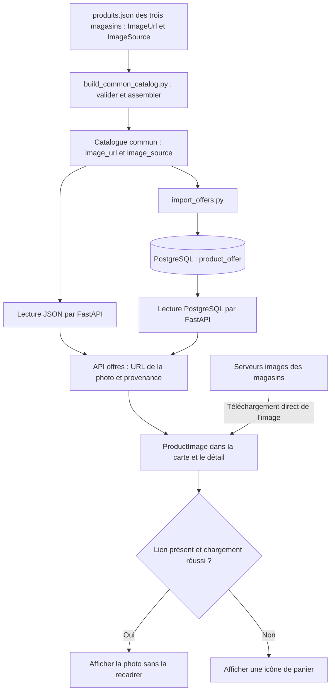

Les champs sont facultatifs : un ancien fichier sans photo reste accepté. L’assembleur vérifie qu’un lien renseigné commence par `https://` et refuse le champ `ImageSource` seul sans champ `ImageUrl`. La migration ajoute aussi une contrainte HTTPS en base. Ces contrôles ne vérifient ni que le lien répond ni que la photo représente le bon produit.

Les lectures JSON et PostgreSQL exposent les mêmes champs dans la liste et le détail des offres. Les contrats exportés dans `backend/contracts/v1/` et le type `Offer` du mobile les incluent. L’identifiant public `offer_…` est calculé sans les champs de photo : changer uniquement l’image ou sa provenance ne change donc pas cet identifiant. Une modification des autres données de l’offre peut le changer.

[ProductImage.tsx](mobile/components/ProductImage.tsx) utilise l’image distante et affiche une icône si l’URL manque ou si le chargement échoue. Le détail indique aussi le magasin comme source de la photo lorsque l’URL est présente. La disponibilité des photos dépend ainsi du réseau et des serveurs des magasins, indépendamment de celle des données de prix.

### Idées repas à partir des promotions

[CookWithPromosScreen.tsx](mobile/app/CookWithPromosScreen.tsx) est la vue **Idées repas** de Promos. Elle charge les recettes accessibles par pages de vingt, puis leurs détails pour connaître leurs ingrédients. Elle charge aussi les promotions actives avec `fetchPromos`, qui reste limité aux **cent premières promotions**, contrairement au chargement complet de la page principale Promos.

Le rapprochement reste effectué dans le mobile, par `ingredient_id`, sans IA. Pour chaque ingrédient, le code retient l’offre au prix affiché le plus bas parmi les promotions admissibles. Il retient une promotion au rabais connu d’au moins 5 %, ou à l’écart de prix d’au moins 1 $ ; un rabais non calculable n’entraîne pas à lui seul son exclusion.

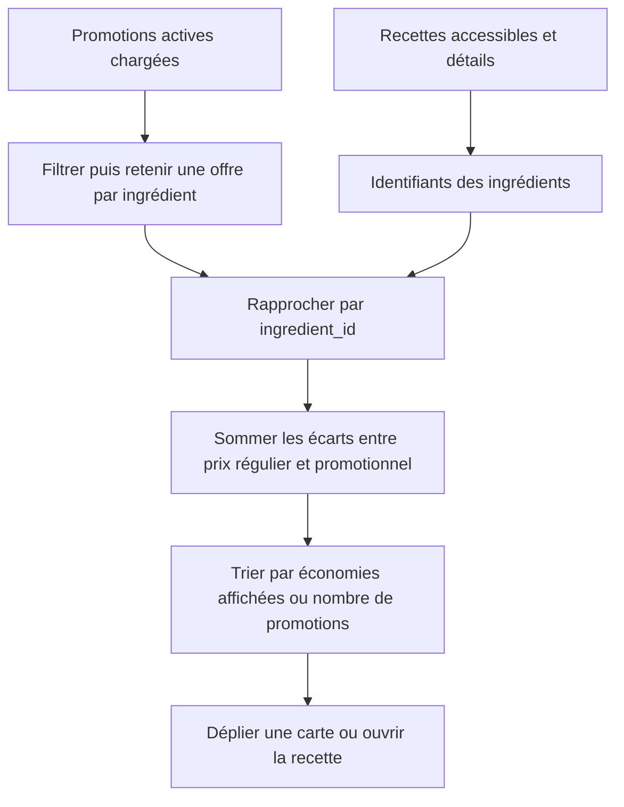

Le tri initial est **Plus d’économies** ; **Plus de promos** inverse les priorités entre économie affichée et nombre d’ingrédients en promotion. Les cartes peuvent être dépliées pour montrer les produits et magasins, puis ouvrir la recette. La fiche est ouverte dans la pile Promos, afin que le retour revienne aux idées repas.

Le montant appelé économie est la somme des écarts entre prix régulier et prix promotionnel des produits retenus. Il n’est ajusté ni aux portions ni aux quantités ou formats nécessaires à la recette. Un écart non calculable contribue zéro à ce classement, sans rendre connu le coût de la recette. Ce montant ne doit donc pas être interprété comme une économie garantie sur un panier complet.

Les évaluations courantes restent visibles lorsqu’elles existent et ne changent pas ces deux tris. Une recette devenue inaccessible entre liste et détail est ignorée sur 404 ; une autre panne reste une erreur affichée.

### Calendrier et repas enregistrés

Le calendrier ajouté depuis `main` le 1er novembre utilise la migration
`0008_meal_plan`. Un compte connecté peut consulter une semaine, choisir une
recette ou une note, ajuster les portions, déplacer, dupliquer ou retirer un
repas, et marquer des restes de recette. Le mobile passe par les routes
`/api/v1/plans` ; le backend filtre les entrées par propriétaire.

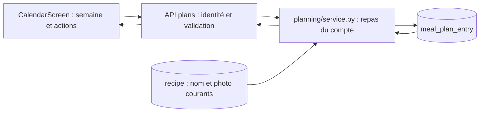

Le nom et la photo viennent de la recette courante. La suppression d’une
recette privée conserve les repas qui la référencent, sans nom ni photo et avec une
référence à NULL depuis `0010_preserve_meals` ; la suppression du compte retire
ses propres repas. Le calendrier n’est pas un historique figé des recettes.
Le parcours vers les listes et le calcul des produits à acheter est intégré,
comme décrit ci-dessous. Les instantanés historiques des plans sont retirés du
périmètre. Voir le [guide du calendrier](backend/docs/PLANNING.md) pour les
routes et les essais sur appareil.

Depuis le 5 novembre, une recette publique ne peut plus être rendue privée ni supprimée par son auteur et reste accessible après suppression de son compte. Pour une référence exceptionnellement devenue inaccessible, le backend
conserve son repas mais renvoie un nom et une photo nuls. Il masque aussi cette
recette dans les favoris du lecteur. Le mobile affiche « Recette indisponible » dans la carte et le menu.
Les portions, le déplacement et le retrait restent possibles ; ouverture,
duplication et nouveaux restes ne sont plus proposés. Le calendrier recharge
les droits au retour dans l’onglet. Le sélecteur n’utilise que les recettes
publiques et celles du compte, ou leurs favoris accessibles.

Le menu d’un repas accessible propose « Voir la recette ».
Cette action ferme le menu et ouvre la fiche de Recettes ; la notation se fait
ensuite depuis cette fiche, avec ses droits et la version courante du contenu.
Une note libre ou une recette indisponible ne propose pas cette action.
Planifier, déplacer ou marquer des restes ne crée aucun vote et ne prouve pas
que la recette a été préparée.

### Vue Épicerie et accès aux listes

Le calendrier propose les vues **Repas** et **Épicerie**. [EpicerieSemaine.tsx](mobile/components/EpicerieSemaine.tsx) calcule les besoins des recettes de la semaine choisie via `calendar-preview`, puis demande les quatre scénarios de prix sans créer de liste.

La date des courses utilisée par cet aperçu est aujourd’hui si le jour appartient à la semaine affichée, sinon le lundi de cette semaine. Les ingrédients sont présentés par rayon. Si les prix échouent, les besoins peuvent rester visibles sans leur chiffrage.

**Créer une liste de produits** reprend le scénario sélectionné : Le moins cher, Maxi, Metro ou Super C. La copie active porte le nom de la semaine, par exemple **Épicerie 16-22 nov**, et s’ouvre directement dans Listes. Retour ramène aux récentes. Les produits, prix, magasins et provenances calendrier sont enregistrés ensemble ; les autres listes restent indépendantes.

Les besoins sans produit chiffrable et les repas inaccessibles sont signalés avant confirmation des seuls produits disponibles. Sans produit disponible, la création est désactivée. Un besoin exclu ne devient pas un article libre dans cette liste de produits.

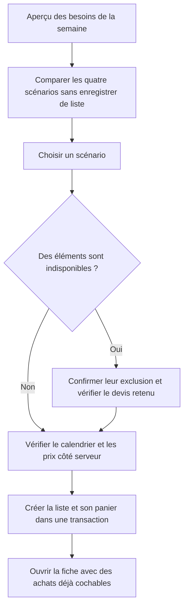

Une **empreinte** résume les données utilisées pour un aperçu. À la création, le serveur vérifie les empreintes du calendrier et des prix : si les données ont changé, il refuse le devis plutôt que d’enregistrer un panier différent sans confirmation. Le prix d’une ligne est rapproché par ingrédient, car le devis et le calendrier ont des identifiants temporaires distincts. La reprise réseau conserve la même commande pour éviter les doublons. Aucun premier appui sur Actualiser les prix n’est nécessaire.

Depuis Accueil, **Créer la liste de la semaine** conserve un autre parcours : confirmer ou modifier les besoins, puis créer une liste d’articles sans magasin ni prix.

### Listes : articles, produits et sauvegardes

Le [guide des listes](backend/docs/SHOPPING_GUIDE.md) détaille les boutons et les cas particuliers. L’onglet **Listes** sépare **Listes récentes** et **Mes listes**. Les récentes montrent les cinq dernières listes actives ou brouillons ; **Voir tout** ouvre une page paginée des listes en cours. **Mes listes** contient les sauvegardes réutilisables.

#### Créer et ajouter

Le **+** propose Articles ou Produits. Le choix crée immédiatement une liste active vide sur le serveur, appelée **Mes courses** ou **Mes produits**, puis ouvre son détail. Une création échouée reste une erreur avec reprise ; aucun détail fictif n’est affiché. Le nom est modifiable. La date de calcul reste une donnée technique, sans date de courses imposée dans ce parcours.

| Type | Ajout proposé | Affichage et achats |
| --- | --- | --- |
| Articles | Ingrédient du catalogue ou texte libre | Besoins cochables, sans magasin ni montant |
| Produits | Produit précis d’une enseigne et d’un magasin | Référence commerciale, format et prix disponible ; achats cochables |

Le type d’une nouvelle liste est immuable. Le backend refuse une modification qui mélangerait articles et produits. Les anciennes listes sans type restent compatibles ; le mobile bloque les nouveaux ajouts dans celles qui sont mixtes.

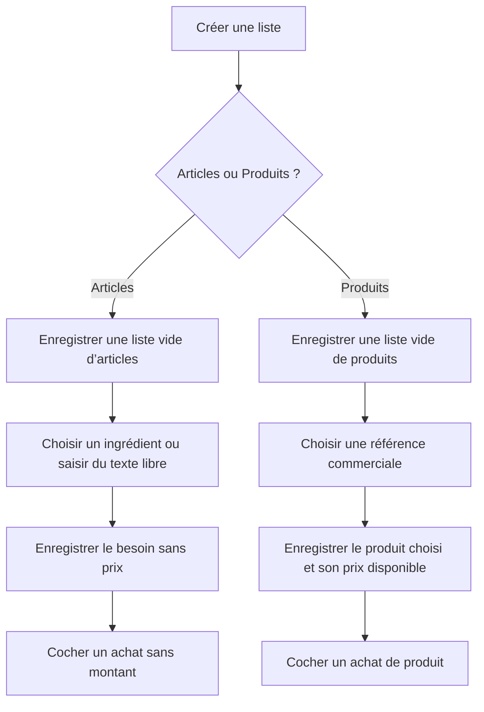

La barre d’ajout utilise le type de liste pour interroger les ingrédients **ou** les offres. Elle attend brièvement après la frappe, annule les recherches dépassées et présente trois résultats par page. Les trois récents sont séparés par compte et par nature d’ajout. Une liste d’articles accepte le texte libre avec Entrée ou Terminé : aucun ingrédient n’est déduit automatiquement de ce texte. Une liste de produits exige de toucher une référence commerciale. Un ingrédient déjà présent propose regroupement ou ligne séparée.

L’ajout conserve les droits, révisions et commandes de reprise. **Terminé** ferme les suggestions ; le bouton **Actualiser les prix**, réservé aux produits, reste désactivé pendant les ajouts. Un produit sans prix valide conserve son identité sans montant inventé.

#### Calculer les besoins et les montants

Le serveur ajuste chaque recette aux portions prévues, puis additionne les quantités du même ingrédient dans les unités compatibles. Les notes libres et les restes sont ignorés pour éviter d’inventer ou de compter deux fois des ingrédients. Les recettes inaccessibles sont signalées et les préférences **Ne plus suggérer** retirent les ingrédients concernés des prochaines générations.

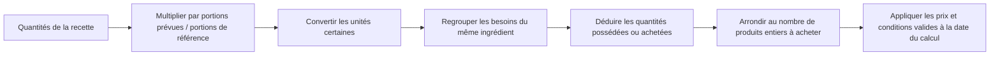

Par exemple, une recette pour quatre personnes qui demande 500 g de riz en demande 750 g pour six. Avec des sacs de 500 g à 3 $, cela donne deux sacs, soit 6 $. L’arrondi aux produits se fait après regroupement des besoins. Les calculs utilisent des décimaux et fractions ; une quantité non représentable exactement en décimal est arrondie par excès à six décimales et signalée.

Les conversions certaines couvrent notamment kg → g, L → ml, tasse → 250 ml, cuillère à table → 15 ml et cuillère à thé → 5 ml. Aucune conversion entre poids et volume n’est inventée. Sans quantité, le calcul direct prévoit une unité de vente. Un format incompatible ou un prix absent laisse le besoin sans prix.

Le scénario **Le moins cher** compare le coût des produits entiers nécessaires pour chaque ingrédient parmi les références disponibles. Il peut répartir les achats sur plusieurs magasins ; il ne calcule pas les frais ou le temps de déplacement. Les promotions sont évaluées à la date du calcul, avec leur limite de quantité et le prix après limite lorsqu’ils sont connus. Le calcul utilise la même source d’offres que Promos : JSON ou PostgreSQL selon `OFFERS_SOURCE`. Il ne déclenche aucune collecte.

Les montants n’apparaissent que lorsqu’un produit chiffré est retenu ou acheté. **Total estimé** signifie que les besoins sont chiffrés ; **Sous-total connu** signale un montant incomplet. Un achat déclaré sans prix peut couvrir un besoin sans créer un coût connu. Les prix restent des estimations issues du catalogue, pas une garantie du montant en caisse.

#### Acheter, modifier et actualiser

Le détail affiche les besoins ou produits à acheter et une section **Achetés**, repliée au départ. Une coche attend la confirmation du serveur ; une erreur restaure l’état précédent. Les produits conservent leur référence et le prix sauvegardé de l’achat.

Toucher une ligne ouvre sa fiche. Pour les articles, elle permet de changer le nom et la quantité. Pour les produits, le nom est immuable ; **Définir la quantité** demande un nombre entier total d’emballages et **Choisir dans un autre magasin** propose des produits du même ingrédient hors du magasin courant.

**J’en ai déjà** retire la ligne après confirmation. **Ne plus suggérer** enregistre d’abord une exclusion d’ingrédient pour les futures générations calendrier, puis retire la ligne ; ces deux écritures restent reprenables séparément. L’exclusion est annulable depuis le menu du compte. **Retirer de la liste** est restaurable. Les anciennes listes mixtes et les routes historiques conservent les déclarations de possession et d’achats partiels.

**Actualiser les prix** recalcule les produits au jour courant en gardant les références explicites. Modifier la quantité ou retirer un produit recalcule le panier dans la même transaction. Une erreur annule l’ensemble de cette modification.

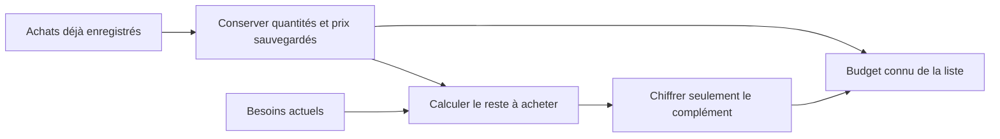

Le budget connu additionne les achats conservés et le complément nouvellement chiffré. Retirer un besoin ne supprime pas le coût des achats passés. Les achats ne sont pas réévalués au nouveau prix du catalogue.

#### Sauvegarder et terminer

**… → Enregistrer dans mes listes** crée une sauvegarde d’articles. Les produits deviennent des ingrédients génériques avec leurs quantités, sans référence commerciale, magasin, prix, achat ou possession. La liste source reste inchangée.

Dans **Mes listes**, **Utiliser cette liste** crée une nouvelle copie active d’articles avec un nouvel identifiant. Le retour mène aux récentes. Les sauvegardes peuvent être renommées, modifiées et supprimées ; leur barre d’ajout utilise la même recherche d’ingrédients et le même texte libre que les listes d’articles. Les anciennes sauvegardes de produits sont aussi présentées et utilisées comme articles. Les routes backend gardent le nom historique `shopping-list-templates`.

Le menu **…** permet aussi de renommer, épingler, terminer ou rouvrir une liste. L’épinglage est conservé côté serveur, mais l’Accueil actuel affiche les listes récentes en cours plutôt que la liste épinglée.

**Terminer la liste** apparaît dans le détail d’une liste active non vide quand tout est couvert. Le menu permet aussi de terminer avec des besoins restants après confirmation, sans les cocher automatiquement. La copie quitte alors les récentes et **Toutes les listes**. Elle reste en base avec ses achats ; les listes sauvegardées restent disponibles. L’écran historique est encore déclaré dans la navigation et l’API sait lire les listes terminées, mais aucun bouton de l’index courant n’ouvre cet historique.

#### Réseau, conflits et reprise

Les listes exigent un compte et un serveur accessible. [ListAccessRequired.tsx](mobile/components/lists/ListAccessRequired.tsx) vérifie une lecture privée à l’entrée et au retour sur l’onglet. Le navigateur déjà autorisé reste monté pendant cette vérification pour préserver la destination demandée depuis Accueil ; un échec affiche Réessayer. Aucun contrôle périodique ni cache complet de listes ne fournit de mode courses hors connexion.

Avant une écriture, [useListCommand.ts](mobile/components/lists/useListCommand.ts) conserve la commande par compte, avec sa clé d’idempotence. Le serveur utilise cette clé pour reconnaître un rejeu et la révision attendue pour refuser un écrasement concurrent.

```mermaid
sequenceDiagram
    participant M as Mobile
    participant L as Stockage local du compte
    participant B as FastAPI et PostgreSQL
    M->>L: Conserver la commande et sa clé
    M->>B: Envoyer la commande avec la révision attendue
    B->>B: Valider puis enregistrer la mutation et son résultat
    alt Réponse reçue
        B-->>M: État confirmé
        M->>L: Retirer la commande locale
    else Réponse perdue
        M->>M: Proposer une reprise manuelle
        M->>B: Renvoyer la même commande avec la même clé
        B-->>M: Résultat déjà enregistré, sans nouvel achat ni recalcul
        M->>L: Retirer la commande locale
    end
```

Un refus explicite 404, 409 ou 422 libère la commande locale. Une erreur réseau ou 503 conserve la demande incertaine pour une reprise manuelle. Un conflit demande de relire l’état courant ; il ne devient pas une réécriture silencieuse. Les réponses dépassées par un changement de compte sont ignorées dans les parcours concernés.

La migration `0023_shopping_list_kind` ajoute le type nullable aux listes et sauvegardes. Les nouvelles listes mobiles sont typées ; les anciennes gardent leur compatibilité. Le contrôle du 20 novembre 2026 confirme que cette migration est appliquée sur la base configurée et que le schéma correspond aux modèles.

## 9. Migrations et imports : deux opérations différentes

**Une migration modifie la structure des tables. Un import remplit les tables avec des données.** Alembic est la seule chaîne de migrations applicatives retenue.

```mermaid
flowchart LR
    A[Fichiers backend/alembic/versions] --> B[Commande Alembic]
    B -->|Créer ou modifier les tables| D[(PostgreSQL)]
    J[JSON des ingrédients, recettes et offres] --> C[Commandes d’import]
    C -->|Insérer les données selon les règles de rejeu| D
    F[FastAPI et SQLAlchemy] <-->|Lire et modifier les données métier| D
```

| Migration | Apport |
| --- | --- |
| `0001_create_ingredient.py` | Référentiel `ingredient` |
| `0002_create_recipes.py` | Tables `recipe` et `recipe_ingredient` |
| `0003_accounts_and_ownership.py` | Profils, propriété et favoris |
| `0004_recipe_metadata.py` | Difficulté et étiquettes |
| `0005_catalog_offers.py` | Tables `category` et `product_offer` |
| `0006_circulars.py` | Table `circular` |
| `0007_product_images.py` | URL et provenance des photos dans `product_offer`, avec contrainte HTTPS |
| `0008_meal_plan.py` | Repas privés dans `meal_plan_entry`, liés à une recette ou une note |
| `0009_recipe_visibility.py` | Recettes privées par défaut, publication volontaire et contraintes de visibilité |
| `0010_preserve_meals.py` | Conservation des repas après suppression d’une recette, sans contenu devenu inaccessible |
| `0011_recipe_ratings.py` | Table des évaluations avec trois notes, unicité par compte et recette, horodatages et cascades |
| `0012_recipe_timestamps.py` | Dates de création et de modification pour les tris ; anciennes dates inconnues conservées à NULL |
| `0013_rating_versions.py` | Votes conservés par version du contenu ; anciennes notes exclues des moyennes et du classement courants |
| `0014_recipe_kitchen_units.py` | Tasses et cuillères acceptées comme unités de recette, sans conversion des quantités existantes ; appliquée sur Supabase le 5 novembre 2026 |
| `0015_permanent_public_recipes.py` | Conservation des recettes publiques sans propriétaire après suppression du compte ; appliquée sur Supabase le 5 novembre 2026 |
| `0016_offer_quantity_limits.py` | Prix promotionnel limité et prix après limite ; appliquée sur Supabase le 14 novembre 2026 |
| `0017_shopping_lists.py` | Tables privées des listes, quantités, contributions, achats manuels et commandes |
| `0018_shopping_comparisons.py` | Résultats de comparaison, choix de produits et panier enregistré |
| `0019_shopping_courses.py` | Achats de produits, quantités et allocations aux besoins |
| `0020_shopping_reuse.py` | Modèles, exclusions et commandes de réutilisation |
| `0021_shopping_list_pin.py` | Préférence privée d’épinglage d’une liste |
| `0022_product_follows.py` | Produits suivis par compte, avec RLS et suppression en cascade du profil |
| `0023_shopping_list_kind.py` | Type Articles / Produits des listes et sauvegardes ; anciennes listes conservées avec un type NULL |

Les commandes se lancent depuis la racine, après configuration du serveur :

```bash
python -m alembic -c backend/alembic.ini upgrade head
python -m backend.cli.import_ingredients
python -m backend.cli.import_recipes
python -m backend.cli.import_offers
```

L’import des ingrédients peut actualiser le référentiel sans supprimer les éléments absents du fichier. L’import des recettes conserve les recettes identiques et annule sa transaction en cas de contenu différent, afin de préserver les corrections existantes. Les dix recettes initiales constituent un jeu de départ ; la base peut accueillir d’autres recettes.

L’import des offres valide le catalogue, puis insère ou actualise les catégories et les produits dans une transaction. Il exige que les ingrédients existent déjà en base et ne supprime pas les offres absentes du fichier. Modifier les fichiers de prix demande donc de reconstruire le catalogue commun et de relancer cet import pour les lectures PostgreSQL.

La tête de migration présente dans le dépôt est `0023_shopping_list_kind`. Le contrôle du 20 novembre 2026 confirme cette révision sur la base configurée et un schéma conforme aux modèles (`alembic check`). Les migrations 0022 (suivis) et 0023 (types de listes) sont donc appliquées. Ce contrôle ne valide pas la synchronisation des suivis entre appareils.

Une migration crée la structure mais ne remplit pas les nouvelles colonnes avec les données du catalogue : les imports restent nécessaires. Les tables et les politiques Storage sont des configurations distinctes ; la commande de configuration des images ne remplace pas Alembic.

FastAPI ne lance automatiquement ni ces migrations, ni ces imports. Le guide [MIGRATIONS.md](backend/docs/MIGRATIONS.md) détaille les migrations et les imports initiaux ; le [guide backend](backend/README.md#promos-et-circulaires-de-la-semaine) décrit la mise à jour des offres et des circulaires.

## 10. D’où viennent les prix et les reçus ?

Ces outils fonctionnent actuellement en ligne de commande. Ouvrir l’application ou consulter une offre ne lance aucune collecte externe.

### Catalogue et prix

```mermaid
flowchart TD
    A[Apify : collecte Maxi ou capture à rejouer] --> C[ingest_catalog.py]
    C --> N[Normalisation et contrôles du catalogue]
    N --> J[Captures et exports JSON Maxi]
    J --> F[Fichiers regroupés Maxi]
    E[Échantillons JSON Metro et Super C] --> B[build_common_catalog.py]
    F --> B
    M[ingredient_mapping.json : correspondances explicites] --> B
    B --> K[Catalogue commun dans data/catalog/baseCommune]
    K --> P[FastAPI : routes ingrédients et offres]
    K --> I[import_ingredients.py]
    I --> D[(PostgreSQL : ingrédients, catégories et offres)]
    K --> O[import_offers.py]
    O --> D
    D -->|Offres si OFFERS_SOURCE vaut database| P
```

Les flèches résument le parcours des données ; certaines préparations sont des étapes distinctes, à lancer ou à vérifier séparément.

| Fichier ou dossier | Utilité |
| --- | --- |
| [price_sources/apify_loblaws.py](backend/app/price_sources/apify_loblaws.py) | Appeler le fournisseur Apify pour Maxi |
| [catalog/apify_command.py](backend/app/catalog/apify_command.py) | Préparer collecte, reprise ou rejeu |
| [catalog/apify_batch.py](backend/app/catalog/apify_batch.py) | Répartir les recherches et leur budget |
| [catalog/apify_ingestion.py](backend/app/catalog/apify_ingestion.py) | Transformer les réponses en catalogue |
| [catalog/common_catalog.py](backend/app/catalog/common_catalog.py) | Assembler les trois enseignes selon la correspondance fournie |
| [catalog/common_schemas.py](backend/app/catalog/common_schemas.py) | Valider les structures du catalogue commun |
| [backend/config/catalog/](backend/config/catalog/) | Ingrédients recherchés, requêtes, lots et succursale |
| [data/catalog/](data/catalog/) | Captures, fichiers regroupés et catalogue commun |

Apify est retenu pour la collecte Maxi. Metro et Super C ont des échantillons JSON ; leur collecte web avec un modèle IA reste à développer et à évaluer. Pour actualiser les promotions, la procédure actuelle prévoit aussi de vérifier les produits dans les circulaires et de reporter les prix dans les fichiers `produits.json`, en respectant le même produit et le même format. Le catalogue commun est ensuite reconstruit avec `python -m backend.cli.build_common_catalog`, puis importé avec `python -m backend.cli.import_offers`.

Les captures ne garantissent pas le prix ni le stock actuels en magasin. Épiceries.ca et l’extraction automatique des prix depuis les PDF restent des pistes abandonnées. L’affichage des circulaires PDF dans l’application est un parcours distinct, décrit ci-dessous.

### Actualiser les prix et les photos des trois magasins

Les fichiers sources sont `data/catalog/maxi/data_final/produits.json`, `data/catalog/metro/produits.json` et `data/catalog/superc/produits.json`. Ils conservent les prix réguliers et promotionnels, dates, formats, liens produits et photos, ainsi que les limites promotionnelles lorsqu’elles sont documentées.

Les données ont reçu une mise à jour hebdomadaire le 19 novembre. Cela ne signifie pas que chaque fiche possède un nouveau relevé ou que tous les produits sont en promotion. Les dates, prix et conditions de chaque fiche font foi ; les promotions expirées ne doivent pas être présentées comme actuelles.

Après vérification et mise à jour des sources, reconstruire le catalogue depuis la racine :

```bash
python -m backend.cli.build_common_catalog
```

Pour les lectures JSON, redémarrer FastAPI pour recharger ce fichier. Pour les offres PostgreSQL, appliquer les migrations nécessaires puis importer :

```bash
python -m alembic -c backend/alembic.ini upgrade head
python -m backend.cli.import_offers
```

Les offres en base sont relues à chaque requête ; les ingrédients HTTP restent chargés depuis le JSON au démarrage. Changer `OFFERS_SOURCE` demande un redémarrage.

`ON_DATE` dans [promos.ts](mobile/components/promos.ts) vaut `undefined` : le backend utilise la date du jour à Toronto. Une date explicite évalue la capture actuellement disponible à cette date ; elle ne restaure pas d’anciens prix. Importer une circulaire en images ne modifie pas les offres.

Les tests des limites promotionnelles utilisent désormais une offre fixe indépendante des mises à jour hebdomadaires. Les contrôles d’assemblage et de parité des données vérifient séparément la cohérence du catalogue courant.

### Préparer et consulter les circulaires

Les PDF sont téléchargés manuellement dans `data/circulars/`. La commande [import_circulars.py](backend/cli/import_circulars.py) prépare leur affichage : elle convertit chaque page en JPEG, envoie les images dans Storage, puis enregistre les informations de la circulaire dans PostgreSQL.

```mermaid
flowchart TD
    P[PDF téléchargé pour un magasin] --> C[import_circulars.py : convertir les pages en JPEG]
    C --> S[Storage : bucket public circulars]
    C --> D[(PostgreSQL : table circular)]
    M[Mobile : ouvrir Circulaires] --> A[GET /api/v1/circulars]
    D --> A
    A --> L[Dates et liens des pages]
    L --> V[Afficher la circulaire du magasin]
    S -->|Images téléchargées directement| V
```

Après création du bucket public `circulars` et configuration de `SUPABASE_SECRET_KEY` côté serveur, un import se lance ainsi :

```bash
python -m backend.cli.import_circulars --retailer maxi --from 2026-10-22 --to 2026-10-28
```

Le fichier attendu ici est `data/circulars/maxi.pdf`. Les mêmes options existent pour `metro` et `superc`. Sans dates explicites, le script prend la semaine du jeudi au mercredi en cours. Il remplace la ligne du magasin et supprime les anciennes images après l’enregistrement de la nouvelle circulaire. Ce parcours conserve la circulaire courante, pas un historique.

Dans le mobile, [CircularsScreen.tsx](mobile/app/CircularsScreen.tsx) présente les magasins, les couvertures et les dates. [CircularScreen.tsx](mobile/app/CircularScreen.tsx) affiche les pages et ouvre l’image d’une page lorsqu’on la touche. Une circulaire terminée est signalée ; elle n’est pas automatiquement masquée. **L’import des images n’extrait aucun prix et ne met pas à jour les offres.**

### Lecture locale des reçus et pilote PC Express

```mermaid
flowchart LR
    P[Photo de reçu] --> O[ocr.py : reconnaître le texte]
    O --> R[parser.py et rules : reconstruire les articles]
    R --> V[validation.py : contrôler les montants]
    V --> J[JSON du reçu à vérifier]
    J --> M[Pilote Maxi : préparer les correspondances]
    U[Liens produits renseignés] --> M
    M --> W[PC Express : actualiser les fiches identifiées]
    J --> F[Vérification locale du JSON extrait]
```

L’OCR utilise Apple Vision sur Mac ou Tesseract + OpenCV. Un profil Super C reconnaît désormais les rayons, les rabais informatifs, les consignes et les corrections de prix. Au 2 novembre, les prix de deux nouveaux reçus Maxi et de cinq reçus Super C ont été vérifiés ligne par ligne avec les deux moteurs sur Mac. Les relectures Tesseract utilisent des modèles locaux supplémentaires, décrits dans le guide des reçus. Le chemin Windows reste à vérifier sur PC ; les noms, quantités et autres champs restent à relire.

Le pilote PC Express est un traitement complémentaire testé sur cinq produits Maxi. [match_maxi_receipts.py](backend/cli/match_maxi_receipts.py) prépare les correspondances puis actualise les produits dont le lien est renseigné ; [web_matching.py](backend/app/receipts/web_matching.py) porte les traitements et [pcx_products.py](backend/app/price_sources/pcx_products.py) récupère les fiches. Ce pilote ne fait pas partie du parcours HTTP des recettes.

Les commandes, résultats et limites sont expliqués dans [RECEIPTS.md](backend/docs/RECEIPTS.md) et [PCX_PILOT.md](backend/docs/PCX_PILOT.md). L’intégration d’une contribution de prix depuis les reçus est retirée du périmètre ; les outils locaux restent utilisables pour lire et vérifier des extractions.

## 11. Retrouver les fichiers utiles dans le dépôt

### Côté mobile

| Fichier ou dossier | Utilité et lien avec les autres |
| --- | --- |
| [App.tsx](mobile/App.tsx) | Assemble AuthProvider, les cinq onglets et les piles Accueil, Recettes, Promos et Listes |
| [app/AuthScreen.tsx](mobile/app/AuthScreen.tsx) | Inscription et connexion à la demande, avec retour au mode visiteur |
| [components/AccountRequired.tsx](mobile/components/AccountRequired.tsx) | Protection des écrans personnels sans bloquer la consultation publique |
| [app/ProfileScreen.tsx](mobile/app/ProfileScreen.tsx) | Profil, déconnexion et suppression du compte |
| [app/CalendarScreen.tsx](mobile/app/CalendarScreen.tsx) | Semaines et actions sur les repas personnels |
| [components/AddMealSheet.tsx](mobile/components/AddMealSheet.tsx) et [components/MealActionsSheet.tsx](mobile/components/MealActionsSheet.tsx) | Choix de recette ou note, portions, déplacement, duplication et restes |
| [app/RecipeListScreen.tsx](mobile/app/RecipeListScreen.tsx) | Recherche, filtres, pagination et cartes |
| [app/RecipeDetailScreen.tsx](mobile/app/RecipeDetailScreen.tsx) | Détail, favoris et actions sur ses recettes |
| [app/RecipeEditorScreen.tsx](mobile/app/RecipeEditorScreen.tsx) | Création guidée en cinq étapes avec photo obligatoire ; édition préremplie des recettes existantes |
| [app/PromotionsScreen.tsx](mobile/app/PromotionsScreen.tsx) | Promotions, recherche, catégories, enseignes et grille/liste |
| [components/search.ts](mobile/components/search.ts) | Pagination complète des offres, alias et recherche tolérante |
| [components/OngletsPromos.tsx](mobile/components/OngletsPromos.tsx) | Navigation Promos, Idées repas et Suivis |
| [app/FollowsScreen.tsx](mobile/app/FollowsScreen.tsx) et [components/follows.ts](mobile/components/follows.ts) | Produits suivis, stockage local et échanges serveur |
| [app/HomeScreen.tsx](mobile/app/HomeScreen.tsx) et [components/MenuCompte.tsx](mobile/components/MenuCompte.tsx) | Tableau de bord et menu du compte |
| [components/EpicerieSemaine.tsx](mobile/components/EpicerieSemaine.tsx) | Aperçu des besoins/prix et accès aux listes depuis Calendrier |
| [app/ListScreen.tsx](mobile/app/ListScreen.tsx) et [app/ShoppingListDetailScreen.tsx](mobile/app/ShoppingListDetailScreen.tsx) | Listes, détail et suivi des courses |
| [app/CreateListScreen.tsx](mobile/app/CreateListScreen.tsx) et [InstantListCreation.tsx](mobile/components/lists/InstantListCreation.tsx) | Choix Articles / Produits et création vide ; confirmation des besoins calendrier depuis Accueil |
| [app/ShoppingAllListsScreen.tsx](mobile/app/ShoppingAllListsScreen.tsx) | Pagination des listes en cours au-delà des cinq récentes |
| [app/ShoppingTemplateDetailScreen.tsx](mobile/app/ShoppingTemplateDetailScreen.tsx) et [app/ShoppingReuseScreen.tsx](mobile/app/ShoppingReuseScreen.tsx) | Sauvegardes réutilisables et création de copies d’articles |
| [components/lists/ListQuickAdd.tsx](mobile/components/lists/ListQuickAdd.tsx) et [services/shoppingRecents.ts](mobile/services/shoppingRecents.ts) | Recherche selon le type de liste et trois récents par compte |
| [services/shoppingCalendarProducts.ts](mobile/services/shoppingCalendarProducts.ts) | Nom hebdomadaire, sélection des besoins chiffrables et contrôle des produits du scénario |
| [components/lists/useListCommand.ts](mobile/components/lists/useListCommand.ts) et [services/shoppingLists.ts](mobile/services/shoppingLists.ts) | Commandes privées, révisions, idempotence et reprise |
| [app/PromoDetailScreen.tsx](mobile/app/PromoDetailScreen.tsx) | Prix, format, dates et lien vers le produit |
| [app/CookWithPromosScreen.tsx](mobile/app/CookWithPromosScreen.tsx) | Idées repas, tris par écarts de prix affichés ou nombre de promotions |
| [app/CircularsScreen.tsx](mobile/app/CircularsScreen.tsx) et [app/CircularScreen.tsx](mobile/app/CircularScreen.tsx) | Choix du magasin et lecture des pages de la circulaire |
| [components/promos.ts](mobile/components/promos.ts) | Chargement des promos et circulaires, affichage des prix, formats et dates |
| [components/ProductImage.tsx](mobile/components/ProductImage.tsx) | Photo distante du produit et icône de remplacement en cas d’absence ou d’erreur |
| [components/](mobile/components/) | Champs, boutons, sélecteur d’ingrédients et affichage des images réutilisés par les écrans |
| [services/api.ts](mobile/services/api.ts) | Requêtes FastAPI, jeton, délai réseau et gestion des erreurs |
| [services/recipeImages.ts](mobile/services/recipeImages.ts) | Galerie, préparation du JPEG et envoi à Storage |
| [services/recipeForm.ts](mobile/services/recipeForm.ts) | Règles de quantités et badges du formulaire |
| [types/api.ts](mobile/types/api.ts) | Types TypeScript des données HTTP |
| [types/navigation.ts](mobile/types/navigation.ts) | Types des écrans et paramètres de navigation |
| [app.json](mobile/app.json) | Configuration Expo et schéma de lien `optimeal` |
| [package.json](mobile/package.json) et `package-lock.json` | Commandes npm et versions des dépendances |
| [eslint.config.js](mobile/eslint.config.js) | Règles Expo du lint ; diagnostics React Compiler en avertissements pour adoption progressive |

Les types TypeScript aident le développeur à utiliser les données correctement. Le backend doit aussi valider les entrées reçues, indépendamment des vérifications du formulaire.

### Guides, configuration et vérifications

Le [guide de Liste](backend/docs/SHOPPING_GUIDE.md) et la [note de refonte](backend/docs/SHOPPING_REFACTOR.md) présentent le fonctionnement courant, les contrats et les validations. Les guides de `backend/docs/` détaillent les contrats et les étapes de réalisation ; certaines de leurs sections datées conservent des descriptions historiques. Le code des routes et des écrans permet de vérifier les parcours effectivement accessibles.

| Emplacement | Rôle |
| --- | --- |
| [README.md](README.md) | Présentation, état du projet, installation et structure |
| [backend/docs/](backend/docs/) | Guides des contrats, de la base, de l’authentification, des images, des prix et des reçus |
| [backend/contracts/v1/](backend/contracts/v1/) | Exports OpenAPI, JSON Schema et exemples pour coordonner backend et mobile |
| [backend/cli/](backend/cli/) | Commandes d’import, de collecte, d’OCR et d’export des contrats |
| [backend/app/catalog/models.py](backend/app/catalog/models.py) | Tables des ingrédients, catégories, offres et circulaires |
| [backend/app/catalog/offer_import.py](backend/app/catalog/offer_import.py) | Validation et import des catégories et offres |
| [backend/alembic/versions/0007_product_images.py](backend/alembic/versions/0007_product_images.py) | Ajout des colonnes de photo ; migration à appliquer avant les lectures d’offres PostgreSQL du code actuel |
| [backend/app/catalog/circulars.py](backend/app/catalog/circulars.py) | Conversion PDF en images, accès Storage et préparation des liens des pages |
| [backend/cli/import_offers.py](backend/cli/import_offers.py) et [backend/cli/import_circulars.py](backend/cli/import_circulars.py) | Mise à jour des offres et des circulaires depuis le terminal |
| [backend/config/storage/recipe_images.sql](backend/config/storage/recipe_images.sql) | Politiques du bucket d’images, appliquées par la commande dédiée ; séparées des migrations applicatives |
| [backend/tests/](backend/tests/) | Tests des règles, routes, imports, autorisations et traitements de données |
| [mobile/tests/](mobile/tests/) | Tests des services, création en cinq étapes, photos natives/Web, accès, listes, achats, reprises et navigation |
| [.github/workflows/backend.yml](.github/workflows/backend.yml) | Tests backend avec PostgreSQL temporaire dans la CI |
| [.github/workflows/mobile.yml](.github/workflows/mobile.yml) | Lint, TypeScript, tests mobiles et export des bundles iOS/Android |
| [.github/workflows/docs.yml](.github/workflows/docs.yml) | Construction du site et publication depuis `main` |
| [docs/](docs/) et [zensical.toml](zensical.toml) | Sources et configuration du site de suivi académique |
| `site/` | Sortie générée par Zensical, à ne pas modifier manuellement |
| `tools/` | Consignes, architecture, décisions et tâches locales, actuellement ignorées par Git |
| [requirements.txt](requirements.txt) | Dépendances Python du backend, des tests et du site |

Les fichiers `__init__.py` identifient les packages Python. Certains fichiers peuvent rester des emplacements réservés ; leur présence ne garantit pas une fonction. À l’inverse, les domaines [shopping_lists](backend/app/shopping_lists/) et [follows](backend/app/follows/) contiennent des routes, modèles et services fonctionnels.

Le [dossier des contrats](backend/contracts/v1/) contient les schémas et exemples partagés. Après changement des routes ou des modèles, `python -m backend.cli.export_shared_contracts` régénère ces exports ; `--check` vérifie leur cohérence sans écrire. Les exports doivent être commités avec le code qui change le contrat.

## 12. Configuration : comment les adresses relient les composants

| Configuration | Utilisation |
| --- | --- |
| `mobile/.env` : `EXPO_PUBLIC_API_URL` | Adresse de FastAPI accessible depuis l’appareil |
| `mobile/.env` : `EXPO_PUBLIC_SUPABASE_URL` | Adresse du projet Supabase pour Auth et Storage |
| `mobile/.env` : `EXPO_PUBLIC_SUPABASE_PUBLISHABLE_KEY` | Clé publique du client Supabase |
| `backend/.env` : `DATABASE_URL` | Connexion PostgreSQL réservée au serveur |
| `backend/.env` : `SUPABASE_URL`, `SUPABASE_PUBLISHABLE_KEY` | Vérification des jetons auprès de Supabase Auth |
| `backend/.env` : `SUPABASE_SECRET_KEY` | Import des circulaires et suppression de compte (Auth et photos) ; clé réservée au serveur |
| `backend/.env` : `OFFERS_SOURCE` | `database` pour lire les offres en base ; JSON par défaut |
| `COMMON_CATALOG_PATH` | Autre chemin éventuel pour le catalogue JSON commun |
| `CATALOG_IMPORT_PATH` | Export utilisé par les anciennes routes `/catalog` |

Les `.env.example` fournissent les noms à renseigner sans secrets réels. Les fichiers `.env` restent locaux. Les variables `EXPO_PUBLIC_…` sont distribuées au mobile : elles doivent contenir uniquement des valeurs publiques, jamais le mot de passe PostgreSQL ou une clé serveur privilégiée.

Le backend charge sa configuration au démarrage ; il faut le redémarrer après un changement. Il faut également redémarrer Expo après modification de la configuration mobile. Les commandes de collecte ont leurs propres options et peuvent demander des variables exportées dans le terminal ; voir leur guide.

Pour démarrer le backend accessible au téléphone, depuis la racine avec l’environnement Python activé :

```bash
python -m uvicorn backend.app.main:app --reload --host 0.0.0.0 --port 8001
```

Dans un autre terminal, depuis `mobile/`, après installation et configuration de l’application de développement :

```bash
npm start -- --dev-client
```

Pour la version web, lancer `npm run web` depuis `mobile/`. Le [README principal](README.md#sur-ordinateur-avec-un-format-de-téléphone) explique le choix de dimensions iPhone ou Samsung dans Chrome.

| Cible | Adresse API habituelle |
| --- | --- |
| Navigateur ou simulateur iPhone sur le Mac | `http://localhost:8001` |
| Émulateur Android standard | `http://10.0.2.2:8001` |
| Téléphone physique | Adresse IP locale de l’ordinateur sur le même réseau |

Le [guide mobile](mobile/README.md) détaille la première compilation, la configuration Auth et les essais sur appareil.

### Appels depuis Expo Web et autorisations CORS

Le backend autorise les origines HTTP sur `localhost` et `127.0.0.1`, avec port facultatif, au moyen de `allow_origin_regex` dans [main.py](backend/app/main.py). Expo Web peut ainsi utiliser un autre port local si 8081 est occupé. Une origine correspond au protocole, à l’hôte et au port de la page qui effectue l’appel. Le navigateur applique la règle CORS lorsque cette origine diffère de celle du backend.

```mermaid
sequenceDiagram
    participant W as Navigateur avec Expo Web sur le port 8081
    participant B as FastAPI sur le port 8001
    W->>B: Vérification préalable OPTIONS si nécessaire
    B-->>W: Origine et en-têtes autorisés par CORS
    W->>B: Requête API avec jeton pour les opérations protégées
    B-->>W: Réponse avec autorisation de lecture par le navigateur
```

Cette configuration couvre les ports locaux correspondant à cette expression. Une origine HTTPS, une adresse IP du réseau ou un domaine web différent demande une configuration adaptée. CORS ne remplace ni la connexion ni les contrôles de propriétaire et ne règle pas un problème de pare-feu ou d’URL inaccessible. Les applications natives iOS et Android ne sont pas soumises à cette restriction du navigateur. Cet ajout ne constitue pas une validation complète de l’application dans sa version web.

## 13. État, validations et limites

### Fonctions présentes dans le code

| Domaine | Fonctionnement courant | Limite à garder visible |
| --- | --- | --- |
| Comptes | Visiteur, inscription, connexion, profil et suppression | Tester les erreurs et changements de compte sur appareils |
| Accueil | Repas du jour ou lendemain, listes en cours et promos suivies | Première page de listes filtrée localement ; épinglage non utilisé dans ce nouvel écran |
| Recettes | Création manuelle en cinq étapes, photos natives/Web, visibilité, favoris, filtres, Petit budget et notation | Publication définitive ; photos publiques dans le prototype |
| Promos | Recherche avec suggestions, catégories, magasins, grille/liste et circulaires | Fraîcheur dépendante des collectes et imports |
| Idées repas | Rapprochement recettes/promos et deux tris | Cent promotions chargées ; économies non ajustées aux quantités des recettes |
| Suivis | Stockage local et persistance serveur complémentaire | Initialisation ponctuelle, pas de synchronisation garantie entre appareils |
| Calendrier | Repas, portions, notes, restes et vue Épicerie | Recettes courantes, sans historique figé des anciennes semaines |
| Listes | Création Articles / Produits, génération de produits depuis Calendrier, coches et actualisation ; fonctionnement global confirmé le 19 novembre | Réseau requis ; données inconnues signalées ; plateforme de validation non précisée |
| Listes sauvegardées | Création, édition, suppression et utilisation mobile ; backend historique des modèles conservé | Nouvelle liste indépendante sans achats ni prix hérités |
| Outils de données | Apify Maxi, imports, OCR local et pilote PC Express | Collecte Metro/Super C à compléter ; Windows OCR à vérifier |

### Validations connues

**20 novembre 2026 — Petit budget.** Le classement par coût interne est intégré
aux trois sections de Recettes, avec recherche, droits et pagination. Les tests
vérifient le prorata des quantités, les unités compatibles, les promotions et
limites, les ingrédients non chiffrables et le changement de classement après
mise à jour des prix en base. La suite backend donne **1 055 tests réussis** sur
PostgreSQL local jetable et **14 tests OCR optionnels ignorés** ; le mobile donne
**315 tests réussis**, TypeScript et lint sans erreur avec 111 avertissements
existants. Les **47 exports de contrats** sont cohérents. Le fonctionnement de
Petit budget est confirmé par un essai utilisateur le 20 novembre ; la plateforme
et le détail des scénarios ne sont pas précisés. Aucun essai sur appareil par
l'agent ni nouvelle génération de bundles n'a été réalisé pour ce filtre. Aucune
migration ni modification de la base Supabase n'était nécessaire.

**20 novembre 2026 — Création des recettes et photos Web.** La création utilise cinq pages ; l’édition conserve le formulaire prérempli. Le bon fonctionnement de l’ajout de photo est confirmé lors d’un essai dans le navigateur après correction de la lecture du fichier. Cette confirmation ne vaut pas nouvel essai sur téléphone ou validation de tous les cas de publication.

Les contrôles mobiles précédant Petit budget ont donné **314 tests réussis**, TypeScript et lint avec **0 erreur et 111 avertissements existants**. Les règles React Compiler introduites progressivement restent en avertissements. Les exports Expo iOS/Android/Web ont été validés lors de la création en cinq étapes, avant la correction photo Web. Ces ajustements mobiles n’avaient pas donné lieu à une nouvelle suite backend ; les résultats du 19 novembre ci-dessous précèdent ceux de Petit budget consignés plus haut.

**19 novembre 2026 — Listes : validation manuelle utilisateur.** Le fonctionnement global de l’onglet Listes est confirmé après essais dans l’état courant, après les derniers ajustements. Cette validation globale inclut l’état livré avec la création des produits depuis Calendrier, le panier initial corrigé et le retrait des blocs d’ingrédients répétés. La plateforme et le détail des scénarios n’ont pas été précisés ; aucune validation distincte de chaque plateforme n’est déduite de cette confirmation. Le périmètre et les prochaines régressions sont consignés dans le [guide des listes](backend/docs/SHOPPING_GUIDE.md#21-parcours-de-vérification).

Les parcours comptes, recettes, photos et Promos ont été confirmés sur iOS et Android le 27 octobre. Des ajustements supplémentaires ont été confirmés sur iOS le 1er novembre, puis globalement sur téléphone le 5 novembre pour les cartes, favoris, unités, publication et notes de Recettes ; la plateforme de cette dernière confirmation n’est pas précisée.

Ces confirmations précèdent les changements récents d’Accueil, de Promos, de Paramètres, d’Épicerie et de persistance des suivis. Elles ne constituent donc pas une validation de ces nouveaux écrans sur iOS et Android.

La vérification backend et contrats du 19 novembre, avant les derniers ajustements mobiles, a donné **1 039 tests backend réussis** avec un PostgreSQL jetable et **14 tests OCR optionnels ignorés**, ainsi que **302 tests mobiles réussis**, TypeScript, **47 exports de contrats cohérents** et les bundles Expo iOS, Android et Web. Les contrôles du comparateur, des ajouts et de la reprise sont décrits dans la [note de refonte](backend/docs/SHOPPING_REFACTOR.md). Ces contrôles automatisés n’incluaient pas d’essai par l’agent sur appareil/simulateur natif pour le clavier et les lecteurs d’écran ; la confirmation manuelle est consignée séparément ci-dessus. Ces résultats vérifient les scénarios automatisés existants ; ils ne prouvent ni une validation visuelle complète ni une synchronisation des suivis entre plusieurs appareils. Séparément, le contrôle du 20 novembre a confirmé la base configurée à `0023_shopping_list_kind (head)` et un schéma conforme aux modèles ; aucune migration supplémentaire n’était nécessaire.

La priorité reste une version stable et les tests utilisateurs. Les préférences détaillées et recommandations économiques restent incomplètes. Les modes IA utilisateur, la gestion avancée du budget, les instantanés historiques des plans/prix, les estimations statistiques et les contributions par reçu sont retirés du périmètre, sans retrait des outils OCR locaux ni de l’historique des listes terminées.

### Parcours actuel : de la semaine de repas aux achats

```mermaid
flowchart TD
    R[Choisir recettes et portions] --> P[Enregistrer les repas dans Calendrier]
    P --> E[Vue Épicerie : besoins et quatre scénarios de prix]
    E --> S[Choisir un scénario et confirmer les éléments indisponibles]
    S --> LP[Créer une liste de produits avec son panier déjà chiffré]
    P --> A[Depuis Accueil : confirmer les besoins de la semaine]
    A --> LA[Créer une liste d’articles sans prix]
    PLUS[Bouton + de Listes] --> K{Quel type ?}
    K -->|Articles| LA
    K -->|Produits| LV[Créer une liste de produits vide]
    LV --> CP[Choisir des produits dans la recherche]
    CP --> PC[Panier de produits enregistrés]
    LP --> PC
    LA --> CA[Cocher les achats sans montant]
    PC --> PA[Cocher les produits et actualiser les prix si nécessaire]
    CA --> FIN[Terminer : conserver en base et retirer des listes en cours]
    PA --> FIN
```

Une liste de produits créée depuis Calendrier est déjà chiffrée et ses achats sont immédiatement cochables. Une actualisation ultérieure conserve les achats et leurs prix sauvegardés. Les besoins sans produit chiffrable sont signalés avant la création, sans être transformés en articles libres dans cette liste de produits.

Les listes sauvegardées de **Mes listes** restent réutilisables indépendamment de la fin d’une copie de courses. L’API conserve les listes terminées ; **Toutes les listes** est la pagination des listes en cours. Ce parcours n’intègre pas de contribution par reçu ni d’historique des versions d’une liste.

### Notation des recettes

La notation est intégrée au détail depuis le 2 novembre 2026. Les migrations
`0011` à `0013` sont appliquées sur Supabase ; le schéma et la conservation des
données ont été vérifiés. Les routes
`PUT` et `DELETE /api/v1/recipes/{id}/rating` enregistrent ou retirent la note
du compte connecté, avec contrôle de visibilité et refus d’autoévaluation.
Le bouton « Noter cette recette » ouvre une fenêtre défilante avec trois
critères : Goût, Fiabilité et Facilité, chacun
avec sa question directement suivie des étoiles pour choisir une note de 1 à 5.
L’introduction est conservée ; les explications supplémentaires et les poids
des critères ne sont plus affichés dans le formulaire.
Un compte peut évaluer une recette publique d’un autre auteur, puis modifier
ou supprimer son évaluation. Sans compte, le bouton propose la connexion.
Les trois notes sont obligatoires et ne sont pas présélectionnées. En
modification, le formulaire charge les notes déjà enregistrées. Annuler ferme
sans enregistrer ; une erreur réseau conserve la saisie. La suppression
demande une confirmation, puis recharge les moyennes. Si ce rechargement
échoue après une suppression réussie, un bouton permet d’actualiser les
moyennes sans renvoyer la suppression.

Le détail affiche la note globale, le nombre d’évaluations et les trois
moyennes, ou « Pas encore évaluée ». Les moyennes Goût, Fiabilité et Facilité
occupent trois colonnes sur une même ligne, avec une icône, le libellé et
une note sur 5 pour chaque critère. Chaque bloc possède aussi un libellé
complet pour les lecteurs d’écran. La note globale pondère le goût à 40 %,
la fiabilité à 40 % et la facilité à 20 %, sans afficher ces poids dans l’interface.
Les fonctions backend calculent déjà les moyennes par critère, la note
pondérée et un score de classement ajusté au nombre de votes. Elles sont
reliées aux routes : les listes incluent les moyennes et leur effectif ; le
détail ajoute uniquement les trois notes du compte connecté. Le tri est
calculé avant pagination et le score de classement reste interne au backend.
Le [guide de notation](backend/docs/RATINGS.md) précise les textes, les droits
et les étapes d’intégration. Le formulaire est couvert par les tests mobiles
et la génération de bundles iOS/Android a été vérifiée lors de son intégration. Le fonctionnement a été confirmé globalement sur téléphone le 2 novembre 2026 ; la plateforme n’est pas précisée. Les notes sur les cartes et les tris sont intégrés. La migration
`0012_recipe_timestamps` ajoute les dates nécessaires sans inventer celles des
recettes déjà présentes ; elle est appliquée sur Supabase. Les recettes
sans note suivent les recettes évaluées dans Mieux notées. Le tri Plus récentes
utilise la publication, ou la création en base si la publication manque ; dans
Mes recettes, le tri utilise seulement la création. Les dates
inconnues sont placées à la fin.

Un changement d’ingrédients, d’étapes, de portions ou de durées ouvre une
nouvelle version évaluée. Les anciens votes restent enregistrés mais ne
comptent plus dans la note et le classement actuels. Un changement de nom,
photo ou visibilité conserve les évaluations courantes. La dernière note
personnelle reste visible dans le détail avec un avertissement si elle est
ancienne ; « Réévaluer la recette » ouvre alors une saisie vide. Supprimer sa
contribution retire toutes ses versions pour la recette après confirmation.
Si le contenu change pendant la saisie, le serveur refuse le vote et le
mobile demande d’actualiser puis de relire la recette. Le versionnement des évaluations ne sauvegarde pas d’anciennes recettes complètes pour les semaines du calendrier.

La suppression du compte retire aussi toutes ses évaluations, anciennes
versions comprises. Supprimer ses recettes retire les votes associés, sans
retirer les votes des autres comptes sur les recettes conservées. Les moyennes
et le classement reflètent les lignes restantes à la lecture suivante. Ce
parcours est couvert par un test de l’API de suppression avec Auth simulé et
PostgreSQL local ; son essai réel avec notation reste à effectuer sur appareil.

La [validation finale](backend/docs/RATINGS_VALIDATION.md) consigne les tests,
les lectures de l’API sur Supabase et l’application des migrations. Les
essais sur téléphone portent sur la notation et sa modification, la
réévaluation après modification de la recette, les liens entre onglets et
les erreurs. Leur bon fonctionnement a été confirmé globalement sur téléphone le 2 novembre 2026 ; les résultats par plateforme ne sont pas détaillés.

## 14. Un ordre de lecture pour explorer le code

Pour suivre un parcours sans lire tout le dépôt à la fois :

1. Ouvrir [App.tsx](mobile/App.tsx) pour repérer les onglets publics et les écrans réservés aux comptes.
2. Lire [AuthContext.tsx](mobile/context/AuthContext.tsx), puis [supabase.ts](mobile/services/supabase.ts), pour comprendre la session.
3. Suivre [RecipeListScreen.tsx](mobile/app/RecipeListScreen.tsx) vers [api.ts](mobile/services/api.ts) pour voir comment part une demande.
4. Repérer le routeur dans [main.py](backend/app/main.py), puis lire [recipes/router.py](backend/app/recipes/router.py).
5. Suivre l’opération dans [recipes/service.py](backend/app/recipes/service.py), avec [security.py](backend/app/security.py) pour l’identité.
6. Lire [recipes/models.py](backend/app/recipes/models.py) et [database.py](backend/app/database.py) pour comprendre la persistance.
7. Refaire le trajet avec [RecipeEditorScreen.tsx](mobile/app/RecipeEditorScreen.tsx) pour comprendre une écriture et l’envoi de photo.
8. Suivre [PromotionsScreen.tsx](mobile/app/PromotionsScreen.tsx) et [components/promos.ts](mobile/components/promos.ts) vers [common/public_router.py](backend/app/common/public_router.py) pour comprendre la lecture des offres.
9. Lire [CookWithPromosScreen.tsx](mobile/app/CookWithPromosScreen.tsx) pour retrouver le rapprochement entre recettes et promotions.
10. Suivre [import_circulars.py](backend/cli/import_circulars.py), puis les écrans Circulaires, pour comprendre le trajet des PDF jusqu’au téléphone.
11. Examiner ensuite les autres outils de catalogue et de reçus selon le besoin.

Pour explorer les autres parcours actuels :

1. Suivre [HomeScreen.tsx](mobile/app/HomeScreen.tsx), [MenuCompte.tsx](mobile/components/MenuCompte.tsx) et [ProfileScreen.tsx](mobile/app/ProfileScreen.tsx) pour les accès de compte.
2. Lire [search.ts](mobile/components/search.ts), [PromoCard.tsx](mobile/components/PromoCard.tsx) et [OngletsPromos.tsx](mobile/components/OngletsPromos.tsx) pour la recherche et les vues de Promos.
3. Suivre [follows.ts](mobile/components/follows.ts) vers [follows/router.py](backend/app/follows/router.py), son service, son modèle et la migration `0022` pour la persistance des suivis.
4. Lire [EpicerieSemaine.tsx](mobile/components/EpicerieSemaine.tsx), [shoppingCalendarProducts.ts](mobile/services/shoppingCalendarProducts.ts) et [draft_pricing.py](backend/app/shopping_lists/draft_pricing.py) pour la création des produits du scénario calendrier. [CreateListScreen.tsx](mobile/app/CreateListScreen.tsx) conserve le formulaire de création d’articles depuis Accueil.
5. Suivre [ShoppingListDetailScreen.tsx](mobile/app/ShoppingListDetailScreen.tsx) vers les services backend [draft_pricing.py](backend/app/shopping_lists/draft_pricing.py), [recalculation.py](backend/app/shopping_lists/recalculation.py) et [courses.py](backend/app/shopping_lists/courses.py) pour les produits, le complément et les achats.

Le [guide détaillé de Liste](backend/docs/SHOPPING_GUIDE.md) complète cet ordre de lecture avec les actions de chaque écran.

Pour une lecture de recette, le trajet à retrouver dans le code est : **écran → client HTTP → route FastAPI → service → PostgreSQL → réponse JSON → écran**. Pour la connexion et les fichiers images, les branches directes vers Auth et Storage complètent ce trajet.

*Dernière mise à jour : 20 novembre 2026*
