# Comprendre le fonctionnement d’OptiMeal

Ce guide explique comment les écrans, le serveur, Supabase et les fichiers du dépôt travaillent ensemble. Il suit des actions concrètes : se connecter, enregistrer une recette avec une photo, consulter les promotions et ouvrir une circulaire.

Il décrit le code présent au **27 octobre 2026**. La présence d’un parcours dans le code ne signifie pas qu’il a été vérifié sur tous les appareils ; les essais confirmés et les fonctions encore prévues sont présentés séparément. Les schémas sont écrits en Mermaid et peuvent être lus dans un aperçu Markdown compatible, notamment sur GitHub.

## 1. Les grandes parties de l’application

Le **frontend** est l’application mobile : il affiche les écrans et reçoit les actions de l’utilisateur. Le **backend** est le serveur : il répond aux demandes du mobile, vérifie les droits et lit ou enregistre les données.

Supabase fournit trois services utilisés par OptiMeal : **Auth** pour les comptes, **PostgreSQL** pour les données et **Storage** pour les images.

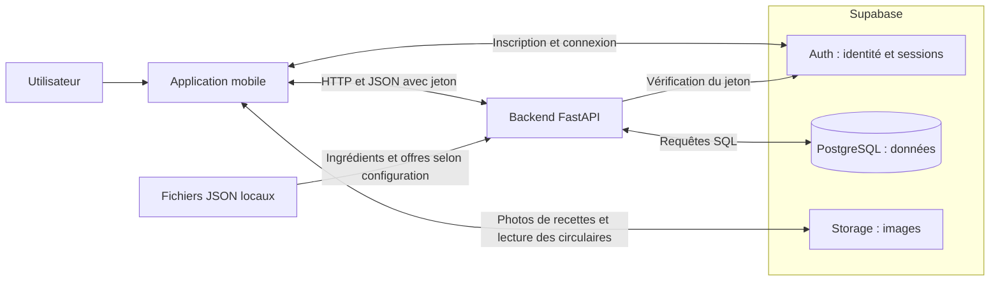

| Partie | Question à laquelle elle répond | Exemple |
| --- | --- | --- |
| Mobile React Native | Que voit et que fait l’utilisateur ? | Remplir le formulaire d’une recette |
| Supabase Auth | Qui est connecté ? | Fournir une session après connexion |
| FastAPI | La demande est-elle valide et autorisée ? | Vérifier que la recette appartient au compte |
| PostgreSQL | Quelles données conserver ou retrouver ? | Enregistrer la recette et ses ingrédients |
| Supabase Storage | Où conserver les fichiers images ? | Héberger les photos de plats et les pages des circulaires |
| JSON locaux | Quelles captures préparées sont disponibles ? | Fournir le catalogue commun des offres |

Le mobile contacte directement Auth et Storage. Pour les tables métier, comme les recettes et les profils, il passe par FastAPI. Les identifiants PostgreSQL restent côté serveur.

## 2. Où fonctionne chaque partie pendant le développement ?

Dans le montage local décrit par le dépôt, l’application fonctionne sur le téléphone, tandis que deux serveurs distincts fonctionnent sur l’ordinateur.

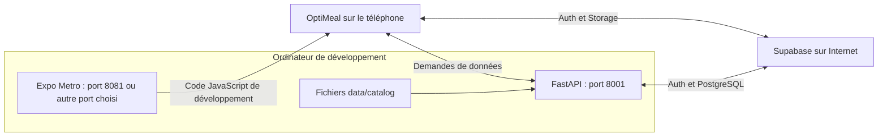

**Expo Metro fournit le code de développement au mobile. FastAPI fournit les données métier.** Le fichier `mobile/metro.config.js` configure le bundler Metro ; il n’a aucun lien avec l’épicerie Metro.

Sur un téléphone, `localhost` désigne le téléphone. L’URL du backend doit donc utiliser l’adresse locale de l’ordinateur, par exemple `http://192.168.1.20:8001`. Cette adresse est un exemple à remplacer. Le téléphone et l’ordinateur doivent pouvoir communiquer sur le réseau.

| Si un composant est arrêté | Conséquence dans ce montage |
| --- | --- |
| FastAPI | Les lectures et enregistrements métier échouent |
| Expo Metro | Le chargement ou l’actualisation du JavaScript de développement est interrompu |
| Accès Internet à Supabase | La connexion, les accès à la base distante et les photos sont affectés |
| Ordinateur | Les deux serveurs locaux deviennent indisponibles |

Pour une utilisation autonome, il faudra une version mobile contenant son code JavaScript et un backend hébergé à une adresse accessible. Le site GitHub Pages actuel héberge la documentation.

## 3. Ouvrir l’application et se connecter

[mobile/App.tsx](mobile/App.tsx) contient la navigation et choisit ce qui doit être affiché selon la session. [AuthContext.tsx](mobile/context/AuthContext.tsx) partage l’état de connexion entre les écrans.

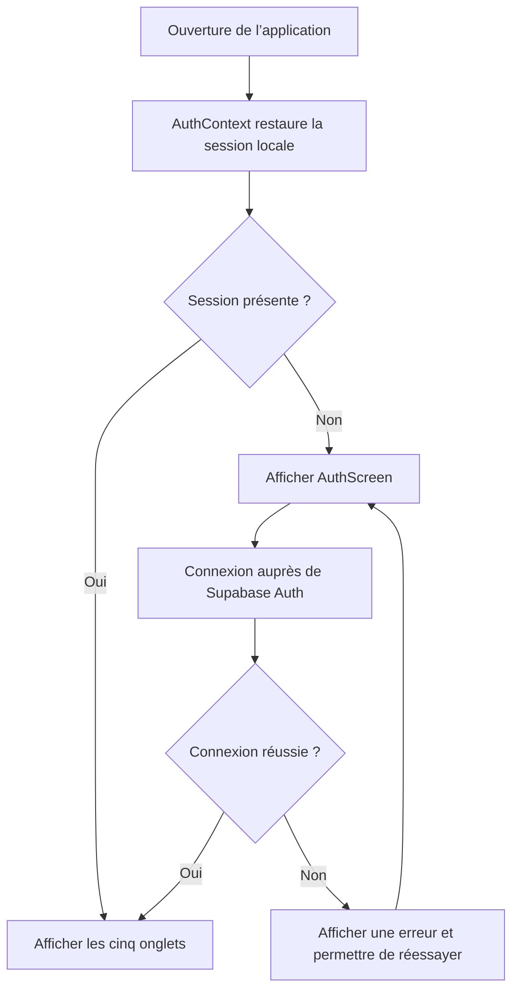

À l’inscription, l’utilisateur doit confirmer son courriel. Le retour dans l’application utilise le lien `optimeal://auth/callback` et un échange de code pour obtenir la session.

Une fois connecté, l’utilisateur retrouve cinq onglets. Accueil affiche un message de bienvenue ; Promos regroupe les offres et les circulaires ; Recettes permet de consulter et gérer les plats ; Calendrier annonce la future planification ; Paramètres donne accès au profil et à la déconnexion. React Navigation organise ces onglets et les écrans de détail de Recettes et Promos.

Le client [services/supabase.ts](mobile/services/supabase.ts) configure Supabase et conserve la session avec AsyncStorage. `AuthContext.tsx` écoute aussi les changements de connexion et gère le retour du lien de confirmation. La session locale permet d’ouvrir l’interface ; chaque demande protégée reste vérifiée par le serveur.

### À quoi sert le jeton ?

Supabase Auth délivre un **jeton d’accès**, aussi appelé JWT. Le mobile le joint aux appels FastAPI dans l’en-tête `Authorization: Bearer …`.

[backend/app/security.py](backend/app/security.py) vérifie ce jeton auprès de Supabase Auth, via `/auth/v1/user`, puis obtient l’identité du compte. Les services métier utilisent cette identité pour contrôler les droits.

Par exemple, être connecté avec le compte B ne donne pas le droit de modifier une recette du compte A. Masquer un bouton dans l’écran améliore l’interface ; le contrôle décisif se fait aussi dans le backend.

## 4. Consulter les recettes : le trajet complet

Une **API** est une interface entre programmes. Ici, le mobile envoie une requête HTTP à FastAPI et reçoit du JSON, un format de données structuré.

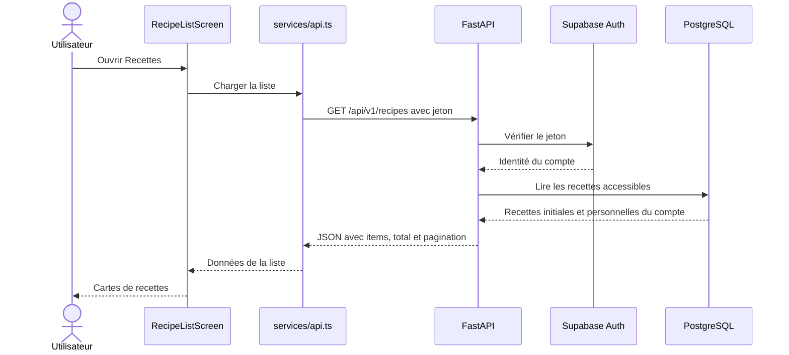

Le fichier [RecipeListScreen.tsx](mobile/app/RecipeListScreen.tsx) demande la liste et affiche les états de chargement, d’erreur ou de résultat vide. Il transmet la recherche et les filtres au serveur :

| Action | Requête correspondante |
| --- | --- |
| Lire les recettes | `GET /api/v1/recipes` |
| Chercher « poulet » | `GET /api/v1/recipes?q=poulet` |
| Voir les recettes rapides | `GET /api/v1/recipes?quick=true` |
| Voir ses favoris | `GET /api/v1/recipes?favorites=true` |
| Lire une recette complète | `GET /api/v1/recipes/{id}` |

Rapides signifie **30 minutes au maximum, préparation et cuisson comprises**. Petit budget affiche encore « Disponible prochainement ».

Sans jeton, l’API permet de lire les recettes initiales. Avec une identité valide, elle ajoute les recettes personnelles de ce compte. L’interface mobile actuelle demande une connexion avant d’afficher les onglets.

## 5. Créer une recette et enregistrer sa photo

Le parcours manuel passe par le choix d’ajout, le choix de saisie et le formulaire. Les choix IA sont visibles, mais leur traitement reste à développer.

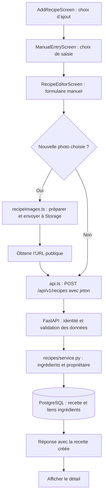

Les responsabilités se répartissent ainsi :

1. Le formulaire recueille le nom, les portions, les durées, les ingrédients, les étapes, la difficulté et les étiquettes.
2. `IngredientPicker.tsx` aide à choisir un ingrédient du référentiel commun. `recipeForm.ts` regroupe des règles de quantités et de badges.
3. Une photo choisie est préparée par `recipeImages.ts` : JPEG, côté maximal de 1 200 pixels et limite de 5 Mo. Son envoi intervient à l’enregistrement.
4. `api.ts` transmet le formulaire à FastAPI avec le jeton.
5. Le backend valide les champs et vérifie que les ingrédients existent en base. Il déduit le propriétaire de l’identité authentifiée.
6. Le service enregistre la recette et ses liens vers les ingrédients dans une transaction PostgreSQL, puis renvoie le résultat.

**L’image et la recette sont enregistrées dans deux services différents.** Storage reçoit le fichier ; PostgreSQL conserve son URL dans `recipe.image_url`. Si l’envoi de l’image réussit mais que la recette ne peut pas être enregistrée, un fichier inutilisé peut rester dans Storage.

Les photos du bucket `recipes-images` sont publiques dans ce prototype. Les politiques Storage limitent les écritures à `users/<identifiant du compte>/`. Retirer une photo enregistre `image_url: null` ; le fichier n’est pas automatiquement supprimé. Cette politique publique concerne les photos de recettes ; le futur parcours des reçus prévoit un stockage privé.

### Modifier, supprimer et mettre en favori

| Demande | Route | Règle principale |
| --- | --- | --- |
| Créer | `POST /api/v1/recipes` | Associer au compte authentifié |
| Modifier | `PUT /api/v1/recipes/{id}` | Vérifier le propriétaire |
| Supprimer | `DELETE /api/v1/recipes/{id}` | Vérifier le propriétaire |
| Ajouter un favori | `PUT /api/v1/recipes/{id}/favorite` | La recette doit être accessible au compte |
| Retirer un favori | `DELETE /api/v1/recipes/{id}/favorite` | Retirer seulement le favori de ce compte |

Les recettes initiales restent communes et ne peuvent pas être modifiées par les utilisateurs. Les favoris sont personnels, y compris lorsqu’ils concernent une recette initiale.

## 6. Pourquoi le backend contient plusieurs fichiers par domaine

Le backend est une seule application FastAPI, organisée par domaines. Cette séparation permet de retrouver une règle sans parcourir tout le serveur.

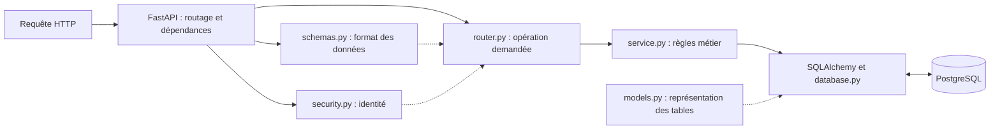

Ce schéma présente les responsabilités. La validation et les dépendances sont exécutées par FastAPI avant l’appel au traitement de la route ; les fichiers ne forment pas une suite d’étapes exécutées ligne par ligne.

| Fichier | Utilité et lien avec les autres |
| --- | --- |
| [main.py](backend/app/main.py) | Crée l’application, ajoute les routeurs et initialise les ressources au démarrage |
| [config.py](backend/app/config.py) | Lit les paramètres, notamment depuis `backend/.env` et l’environnement |
| [security.py](backend/app/security.py) | Fournit l’identité vérifiée aux routes protégées |
| [database.py](backend/app/database.py) | Configure le moteur PostgreSQL et fournit une session SQLAlchemy par requête |
| [recipes/router.py](backend/app/recipes/router.py) | Associe les routes HTTP aux opérations sur les recettes |
| [recipes/schemas.py](backend/app/recipes/schemas.py) | Définit les champs acceptés et retournés, avec leur validation |
| [recipes/service.py](backend/app/recipes/service.py) | Applique la visibilité, les contrôles de propriétaire, les écritures et les favoris |
| [recipes/models.py](backend/app/recipes/models.py) | Représente les tables `recipe`, `recipe_ingredient` et `favorite` |
| [accounts/router.py](backend/app/accounts/router.py) | Expose l’identité et la lecture/modification du profil minimal |
| [accounts/service.py](backend/app/accounts/service.py) | Assure notamment la création du profil applicatif si nécessaire |

**SQLAlchemy** permet de construire les requêtes et de manipuler les données depuis Python. **Psycopg** est le pilote qui communique avec PostgreSQL. **Pydantic** valide les formats échangés par l’API. Ces outils remplissent des rôles complémentaires.

## 7. Quelles données sont conservées dans Supabase ?

Auth gère les comptes dans son propre schéma. Les tables applicatives décrivent ensuite les profils, les recettes et leurs relations.

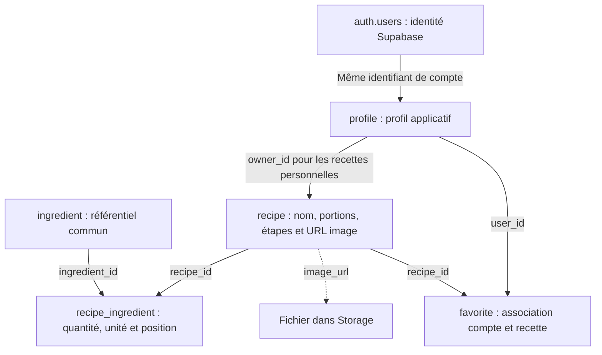

Une recette contient plusieurs lignes `recipe_ingredient`. Chaque ligne relie la recette à un ingrédient et porte la quantité nécessaire. Un même ingrédient peut ainsi servir dans plusieurs recettes.

Les étapes sont conservées dans un champ JSON de `recipe`. Le lien `image_url` est une URL de fichier ; ce n’est pas une clé étrangère PostgreSQL vers Storage.

Pour les recettes initiales, `owner_id` est nul et `seed_key` identifie la recette importée. Pour une recette personnelle, `owner_id` référence le profil du propriétaire.

Le catalogue et les circulaires disposent aussi de tables :

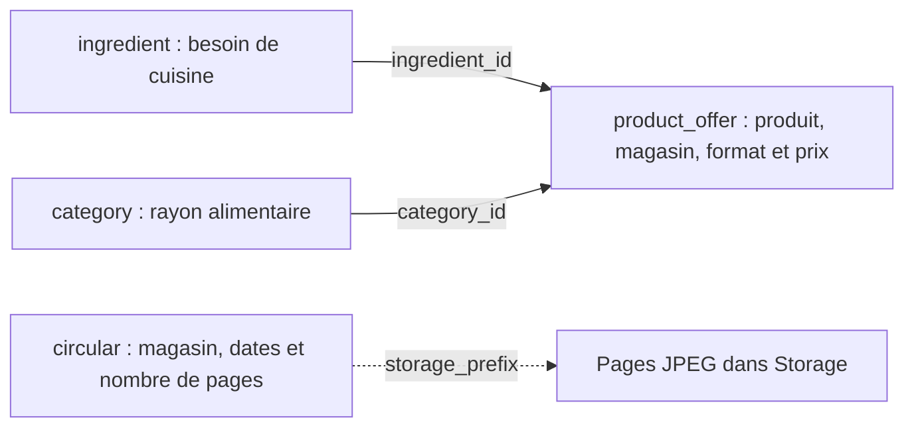

`product_offer` conserve le prix de base, le prix promotionnel éventuel, les dates et la source. Un nouvel import actualise le produit de même identifiant ; cette table ne conserve pas encore l’historique des prix. `circular` garde une seule circulaire par magasin et les informations nécessaires pour retrouver ses images dans le bucket public `circulars`.

### Ingrédient et produit commercial : quelle différence ?

Un ingrédient décrit un besoin de cuisine, par exemple une tomate fraîche. Un produit décrit ce qu’un magasin vend, avec son format, sa source et son prix relevé.

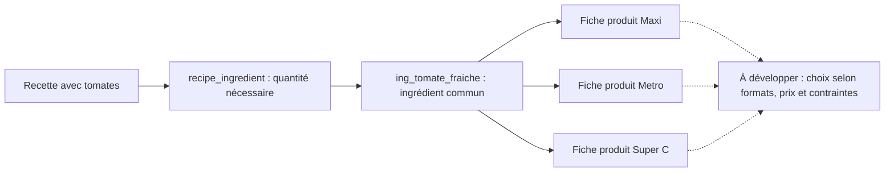

Le référentiel commun contient **31 ingrédients et 93 fiches produits**. Les clés `ing_…` permettent aux recettes et au catalogue de désigner le même ingrédient. Les identifiants propres aux magasins ne suffisent pas : un même numéro peut désigner deux aliments différents selon la source.

Les correspondances sont explicites et restent à vérifier selon les produits. Relier deux fiches à un ingrédient commun ne prouve pas que leurs formats ou leurs qualités sont interchangeables.

## 8. Pourquoi certaines routes lisent encore des JSON

Le raccordement à PostgreSQL avance par étapes. Le référentiel des ingrédients existe déjà en base pour les relations des recettes, mais sa route HTTP lit encore le catalogue JSON commun.

| Données ou route | Source utilisée actuellement |
| --- | --- |
| `/api/v1/recipes` et détail | PostgreSQL, relu à chaque requête |
| Profil et favoris | PostgreSQL |
| `/api/v1/ingredients` | Catalogue JSON commun chargé au démarrage |
| `/api/v1/offers` et détail | JSON par défaut, ou PostgreSQL avec `OFFERS_SOURCE=database` |
| `/api/v1/circulars` | PostgreSQL pour les informations ; Storage pour les images des pages |
| `/catalog` et `/catalog/offers` | Ancien export choisi avec `CATALOG_IMPORT_PATH` |
| Fichiers images | Supabase Storage |

[common/public_data.py](backend/app/common/public_data.py) prépare les données exposées depuis le JSON ou les offres en base. [common/public_router.py](backend/app/common/public_router.py) fournit les routes des ingrédients, des offres et des circulaires.

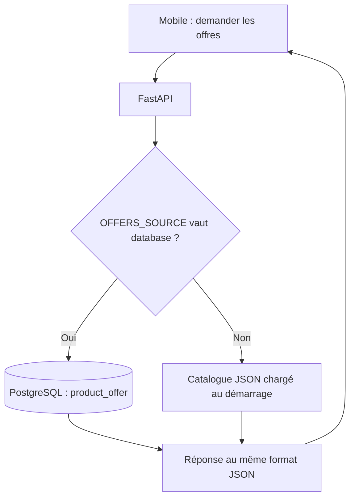

Le choix de source se fait au démarrage du serveur. Le mobile utilise la même route dans les deux cas. Les offres sont évaluées à la date du jour à Toronto, ou à la date fournie avec `on_date`. `promotion_only=true` conserve uniquement les promotions déclarées dont les dates permettent de confirmer qu’elles sont actives.

Le fichier commun par défaut est [data/catalog/baseCommune/ingredients.json](data/catalog/baseCommune/ingredients.json). Modifier ce fichier demande un redémarrage du serveur pour ses lectures HTTP. Modifier le JSON des recettes initiales ne change pas directement les recettes déjà en base : celles-ci passent par une commande d’import explicite.

Une panne PostgreSQL produit une erreur sur les routes qui en dépendent : recettes, profils, circulaires et offres lorsque la source choisie est la base. Elles ne basculent pas silencieusement sur une copie JSON. Le catalogue commun reste nécessaire, notamment pour vérifier les identifiants d’ingrédients dans la liste des offres. `/health` indique que le serveur répond ; `/health/db` vérifie la connexion par `SELECT 1`, sans garantir la présence de toutes les tables.

### Consulter les promotions

[PromotionsScreen.tsx](mobile/app/PromotionsScreen.tsx) demande les offres actives avec `GET /api/v1/offers?promotion_only=true&limit=100`. La recherche par nom et le filtre Maxi, Metro ou Super C sont ensuite appliqués dans le mobile. Les cartes sont triées par pourcentage de rabais décroissant et ouvrent le détail de l’offre.

Le détail présente le prix, le format, le prix par unité lorsque le format est reconnu, les dates et le lien vers le site du magasin. « Ajouter à la liste » affiche encore un message d’attente. Le chargement actuel porte sur les 100 premières offres ; les pages suivantes ne sont pas récupérées par cet écran.

### Trouver une recette avec les promos

[CookWithPromosScreen.tsx](mobile/app/CookWithPromosScreen.tsx) réutilise les promotions et charge les recettes accessibles au compte, puis leur détail pour connaître les ingrédients.

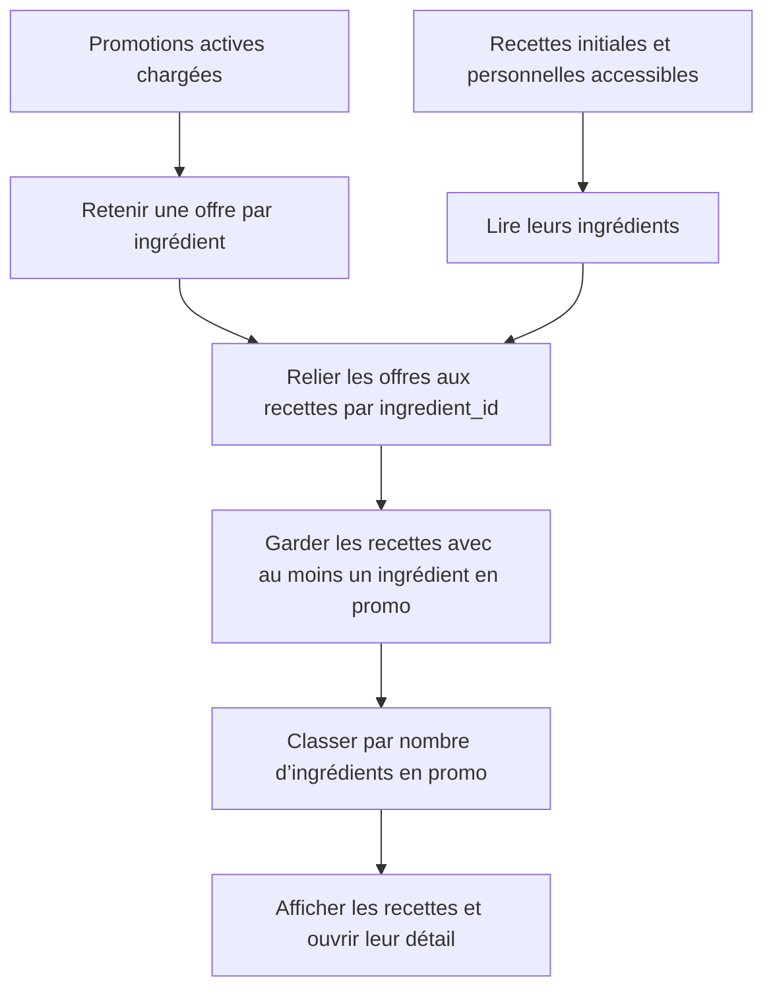

Pour chaque ingrédient, le code retient l’offre au prix affiché le plus bas parmi celles chargées. Cette comparaison porte sur le prix du produit, sans ajustement aux formats ou aux quantités de la recette. Le classement ne calcule donc ni un coût total ni le panier le moins cher. Il fonctionne sans IA et reste distinct du filtre « Petit budget », encore à développer.

## 9. Migrations et imports : deux opérations différentes

**Une migration modifie la structure des tables. Un import remplit les tables avec des données.** Alembic est la seule chaîne de migrations applicatives retenue.

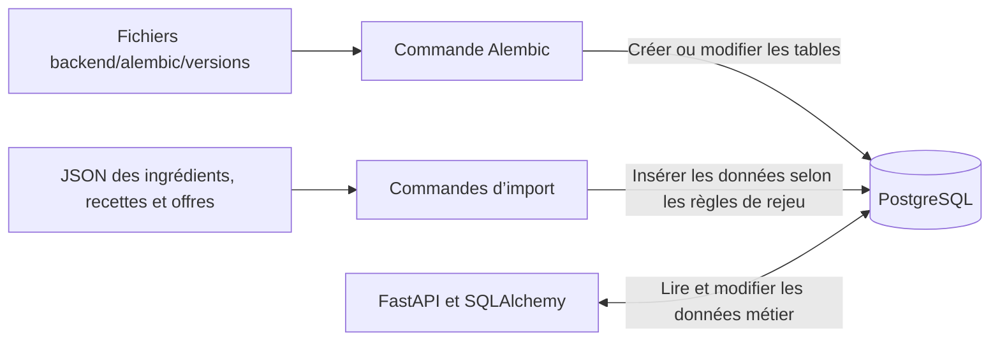

| Migration | Apport |
| --- | --- |
| `0001_create_ingredient.py` | Référentiel `ingredient` |
| `0002_create_recipes.py` | Tables `recipe` et `recipe_ingredient` |
| `0003_accounts_and_ownership.py` | Profils, propriété et favoris |
| `0004_recipe_metadata.py` | Difficulté et étiquettes |
| `0005_catalog_offers.py` | Tables `category` et `product_offer` |
| `0006_circulars.py` | Table `circular` |

Les commandes se lancent depuis la racine, après configuration du serveur :

```bash
python -m alembic -c backend/alembic.ini upgrade head
python -m backend.cli.import_ingredients
python -m backend.cli.import_recipes
python -m backend.cli.import_offers
```

L’import des ingrédients peut actualiser le référentiel sans supprimer les éléments absents du fichier. L’import des recettes conserve les recettes identiques et annule sa transaction en cas de contenu différent, afin de préserver les corrections existantes. Les dix recettes initiales constituent un jeu de départ ; la base peut accueillir d’autres recettes.

L’import des offres valide le catalogue, puis insère ou actualise les catégories et les produits dans une transaction. Il exige que les ingrédients existent déjà en base et ne supprime pas les offres absentes du fichier. Modifier les fichiers de prix demande donc de reconstruire le catalogue commun et de relancer cet import pour les lectures PostgreSQL.

FastAPI ne lance automatiquement ni ces migrations, ni ces imports. Le guide [MIGRATIONS.md](backend/docs/MIGRATIONS.md) détaille les migrations et les imports initiaux ; le [guide backend](backend/README.md#promos-et-circulaires-de-la-semaine) décrit la mise à jour des offres et des circulaires.

## 10. D’où viennent les prix et les reçus ?

Ces outils fonctionnent actuellement en ligne de commande. Ouvrir l’application ou consulter une offre ne lance aucune collecte externe.

### Catalogue et prix

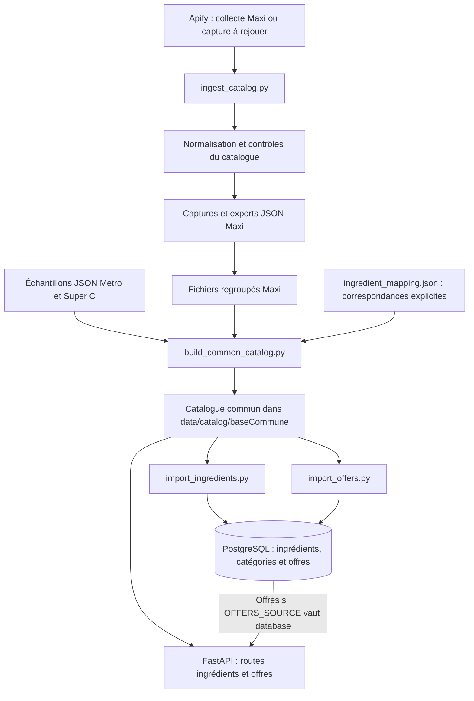

Les flèches résument le parcours des données ; certaines préparations sont des étapes distinctes, à lancer ou à vérifier séparément.

| Fichier ou dossier | Utilité |
| --- | --- |
| [price_sources/apify_loblaws.py](backend/app/price_sources/apify_loblaws.py) | Appeler le fournisseur Apify pour Maxi |
| [catalog/apify_command.py](backend/app/catalog/apify_command.py) | Préparer collecte, reprise ou rejeu |
| [catalog/apify_batch.py](backend/app/catalog/apify_batch.py) | Répartir les recherches et leur budget |
| [catalog/apify_ingestion.py](backend/app/catalog/apify_ingestion.py) | Transformer les réponses en catalogue |
| [catalog/common_catalog.py](backend/app/catalog/common_catalog.py) | Assembler les trois enseignes selon la correspondance fournie |
| [catalog/common_schemas.py](backend/app/catalog/common_schemas.py) | Valider les structures du catalogue commun |
| [backend/config/catalog/](backend/config/catalog/) | Ingrédients recherchés, requêtes, lots et succursale |
| [data/catalog/](data/catalog/) | Captures, fichiers regroupés et catalogue commun |

Apify est retenu pour la collecte Maxi. Metro et Super C ont des échantillons JSON ; leur collecte web avec un modèle IA reste à développer et à évaluer. Pour actualiser les promotions, la procédure actuelle prévoit aussi de vérifier les produits dans les circulaires et de reporter les prix dans les fichiers `produits.json`, en respectant le même produit et le même format. Le catalogue commun est ensuite reconstruit avec `python -m backend.cli.build_common_catalog`, puis importé avec `python -m backend.cli.import_offers`.

Les captures ne garantissent pas le prix ni le stock actuels en magasin. Épiceries.ca et l’extraction automatique des prix depuis les PDF restent des pistes abandonnées. L’affichage des circulaires PDF dans l’application est un parcours distinct, décrit ci-dessous.

### Préparer et consulter les circulaires

Les PDF sont téléchargés manuellement dans `data/circulars/`. La commande [import_circulars.py](backend/cli/import_circulars.py) prépare leur affichage : elle convertit chaque page en JPEG, envoie les images dans Storage, puis enregistre les informations de la circulaire dans PostgreSQL.

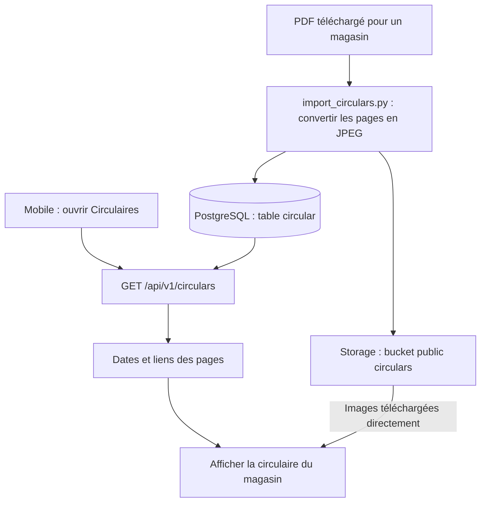

Après création du bucket public `circulars` et configuration de `SUPABASE_SECRET_KEY` côté serveur, un import se lance ainsi :

```bash
python -m backend.cli.import_circulars --retailer maxi --from 2026-10-22 --to 2026-10-28
```

Le fichier attendu ici est `data/circulars/maxi.pdf`. Les mêmes options existent pour `metro` et `superc`. Sans dates explicites, le script prend la semaine du jeudi au mercredi en cours. Il remplace la ligne du magasin et supprime les anciennes images après l’enregistrement de la nouvelle circulaire. Ce parcours conserve la circulaire courante, pas un historique.

Dans le mobile, [CircularsScreen.tsx](mobile/app/CircularsScreen.tsx) présente les magasins, les couvertures et les dates. [CircularScreen.tsx](mobile/app/CircularScreen.tsx) affiche les pages et ouvre l’image d’une page lorsqu’on la touche. Une circulaire terminée est signalée ; elle n’est pas automatiquement masquée. **L’import des images n’extrait aucun prix et ne met pas à jour les offres.**

### Lecture locale des reçus et pilote PC Express

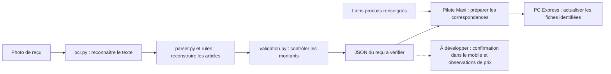

L’OCR utilise Apple Vision sur Mac ou Tesseract + OpenCV. Le chemin Windows et les reçus Super C restent à valider. Des sommes cohérentes ne garantissent pas que tous les articles ont été correctement reconnus.

Le pilote PC Express est un traitement complémentaire testé sur cinq produits Maxi. [match_maxi_receipts.py](backend/cli/match_maxi_receipts.py) prépare les correspondances puis actualise les produits dont le lien est renseigné ; [web_matching.py](backend/app/receipts/web_matching.py) porte les traitements et [pcx_products.py](backend/app/price_sources/pcx_products.py) récupère les fiches. Ce pilote ne fait pas partie du parcours HTTP des recettes.

Les commandes, résultats et limites sont expliqués dans [RECEIPTS.md](backend/docs/RECEIPTS.md) et [PCX_PILOT.md](backend/docs/PCX_PILOT.md). La future contribution de prix sera facultative et nécessitera une correction puis une confirmation de l’utilisateur.

## 11. Retrouver les fichiers utiles dans le dépôt

### Côté mobile

| Fichier ou dossier | Utilité et lien avec les autres |
| --- | --- |
| [App.tsx](mobile/App.tsx) | Assemble AuthProvider, les cinq onglets et les navigations Recettes et Promos |
| [app/AuthScreen.tsx](mobile/app/AuthScreen.tsx) | Inscription et connexion via le client Supabase |
| [app/ProfileScreen.tsx](mobile/app/ProfileScreen.tsx) | Profil minimal via FastAPI et déconnexion via Auth |
| [app/RecipeListScreen.tsx](mobile/app/RecipeListScreen.tsx) | Recherche, filtres, pagination et cartes |
| [app/RecipeDetailScreen.tsx](mobile/app/RecipeDetailScreen.tsx) | Détail, favoris et actions sur ses recettes |
| [app/AddRecipeScreen.tsx](mobile/app/AddRecipeScreen.tsx) | Choix entre les trois modes d’ajout |
| [app/ManualEntryScreen.tsx](mobile/app/ManualEntryScreen.tsx) | Choix formulaire ou texte ; le texte IA reste prévu |
| [app/RecipeEditorScreen.tsx](mobile/app/RecipeEditorScreen.tsx) | Création et modification manuelles avec photo facultative |
| [app/PromotionsScreen.tsx](mobile/app/PromotionsScreen.tsx) | Promotions actives, recherche et filtre par magasin |
| [app/PromoDetailScreen.tsx](mobile/app/PromoDetailScreen.tsx) | Prix, format, dates et lien vers le produit |
| [app/CookWithPromosScreen.tsx](mobile/app/CookWithPromosScreen.tsx) | Recettes classées par nombre d’ingrédients en promotion |
| [app/CircularsScreen.tsx](mobile/app/CircularsScreen.tsx) et [app/CircularScreen.tsx](mobile/app/CircularScreen.tsx) | Choix du magasin et lecture des pages de la circulaire |
| [components/promos.ts](mobile/components/promos.ts) | Chargement des promos et circulaires, affichage des prix, formats et dates |
| [components/](mobile/components/) | Champs, boutons, sélecteur d’ingrédients et affichage des images réutilisés par les écrans |
| [services/api.ts](mobile/services/api.ts) | Requêtes FastAPI, jeton, délai réseau et gestion des erreurs |
| [services/recipeImages.ts](mobile/services/recipeImages.ts) | Galerie, préparation du JPEG et envoi à Storage |
| [services/recipeForm.ts](mobile/services/recipeForm.ts) | Règles de quantités et badges du formulaire |
| [types/api.ts](mobile/types/api.ts) | Types TypeScript des données HTTP |
| [types/navigation.ts](mobile/types/navigation.ts) | Types des écrans et paramètres de navigation |
| [app.json](mobile/app.json) | Configuration Expo et schéma de lien `optimeal` |
| [package.json](mobile/package.json) et `package-lock.json` | Commandes npm et versions des dépendances |

Les types TypeScript aident le développeur à utiliser les données correctement. Le backend doit aussi valider les entrées reçues, indépendamment des vérifications du formulaire.

### Guides, configuration et vérifications

| Emplacement | Rôle |
| --- | --- |
| [README.md](README.md) | Présentation, état du projet, installation et structure |
| [backend/docs/](backend/docs/) | Guides des contrats, de la base, de l’authentification, des images, des prix et des reçus |
| [backend/contracts/v1/](backend/contracts/v1/) | Exports OpenAPI, JSON Schema et exemples pour coordonner backend et mobile |
| [backend/cli/](backend/cli/) | Commandes d’import, de collecte, d’OCR et d’export des contrats |
| [backend/app/catalog/models.py](backend/app/catalog/models.py) | Tables des ingrédients, catégories, offres et circulaires |
| [backend/app/catalog/offer_import.py](backend/app/catalog/offer_import.py) | Validation et import des catégories et offres |
| [backend/app/catalog/circulars.py](backend/app/catalog/circulars.py) | Conversion PDF en images, accès Storage et préparation des liens des pages |
| [backend/cli/import_offers.py](backend/cli/import_offers.py) et [backend/cli/import_circulars.py](backend/cli/import_circulars.py) | Mise à jour des offres et des circulaires depuis le terminal |
| [backend/config/storage/recipe_images.sql](backend/config/storage/recipe_images.sql) | Politiques du bucket d’images, appliquées par la commande dédiée ; séparées des migrations applicatives |
| [backend/tests/](backend/tests/) | Tests des règles, routes, imports, autorisations et traitements de données |
| [mobile/tests/](mobile/tests/) | Tests du service photo et des règles du formulaire |
| [.github/workflows/backend.yml](.github/workflows/backend.yml) | Tests backend avec PostgreSQL temporaire dans la CI |
| [.github/workflows/mobile.yml](.github/workflows/mobile.yml) | Vérification TypeScript et export des bundles iOS/Android |
| [.github/workflows/docs.yml](.github/workflows/docs.yml) | Construction du site et publication depuis `main` |
| [docs/](docs/) et [zensical.toml](zensical.toml) | Sources et configuration du site de suivi académique |
| `site/` | Sortie générée par Zensical, à ne pas modifier manuellement |
| `tools/` | Consignes, architecture, décisions et tâches locales, actuellement ignorées par Git |
| [requirements.txt](requirements.txt) | Dépendances Python du backend, des tests et du site |

Les fichiers `__init__.py` identifient les packages Python. Un fichier présent peut encore être un emplacement réservé : c’est notamment le cas des domaines planning/listes et de `backend/tests/conftest.py`.

## 12. Configuration : comment les adresses relient les composants

| Configuration | Utilisation |
| --- | --- |
| `mobile/.env` : `EXPO_PUBLIC_API_URL` | Adresse de FastAPI accessible depuis l’appareil |
| `mobile/.env` : `EXPO_PUBLIC_SUPABASE_URL` | Adresse du projet Supabase pour Auth et Storage |
| `mobile/.env` : `EXPO_PUBLIC_SUPABASE_PUBLISHABLE_KEY` | Clé publique du client Supabase |
| `backend/.env` : `DATABASE_URL` | Connexion PostgreSQL réservée au serveur |
| `backend/.env` : `SUPABASE_URL`, `SUPABASE_PUBLISHABLE_KEY` | Vérification des jetons auprès de Supabase Auth |
| `backend/.env` : `SUPABASE_SECRET_KEY` | Envoi et suppression des images par la commande d’import des circulaires ; clé réservée au serveur |
| `backend/.env` : `OFFERS_SOURCE` | `database` pour lire les offres en base ; JSON par défaut |
| `COMMON_CATALOG_PATH` | Autre chemin éventuel pour le catalogue JSON commun |
| `CATALOG_IMPORT_PATH` | Export utilisé par les anciennes routes `/catalog` |

Les `.env.example` fournissent les noms à renseigner sans secrets réels. Les fichiers `.env` restent locaux. Les variables `EXPO_PUBLIC_…` sont distribuées au mobile : elles doivent contenir uniquement des valeurs publiques, jamais le mot de passe PostgreSQL ou une clé serveur privilégiée.

Le backend charge sa configuration au démarrage ; il faut le redémarrer après un changement. Il faut également redémarrer Expo après modification de la configuration mobile. Les commandes de collecte ont leurs propres options et peuvent demander des variables exportées dans le terminal ; voir leur guide.

Pour démarrer le backend accessible au téléphone, depuis la racine avec l’environnement Python activé :

```bash
python -m uvicorn backend.app.main:app --reload --host 0.0.0.0 --port 8001
```

Dans un autre terminal, depuis `mobile/`, après installation et configuration de l’application de développement :

```bash
npm start -- --dev-client
```

Le [guide mobile](mobile/README.md) détaille la première compilation, la configuration Auth et les essais sur appareil.

## 13. Ce qui fonctionne et le parcours encore à construire

| État au 27 octobre 2026 | Parcours |
| --- | --- |
| Confirmé sur iOS et Android | Inscription, confirmation du courriel, connexion, session persistante et profil minimal |
| Confirmé sur iOS et Android | Consultation, recherche, Rapides, recettes manuelles et favoris ; séparation de deux comptes aussi vérifiée sur iPhone |
| Confirmé sur iOS et Android | Photo de galerie, hébergement Storage et URL enregistrée dans la recette |
| Outils locaux disponibles | Collecte Maxi, catalogue commun, OCR et pilote PC Express |
| Implémenté dans le code | Tables et import des catégories/offres ; choix de lecture JSON ou PostgreSQL |
| Confirmé sur iOS et Android | Consultation des promos, détail et recettes associées aux ingrédients en promotion |
| Import disponible, lecture confirmée sur iOS et Android | Circulaires en images dans Storage et consultation dans le mobile |
| À développer | Collecte web IA Metro/Super C |
| À développer | Modes IA des recettes, Petit budget et calcul des coûts |
| À développer | Calendrier sauvegardé, historique et listes modifiables par magasin |
| À développer | Confirmation des reçus dans le mobile, contributions et estimations de prix |
| À compléter | Scénarios d’erreur réseau et essais sur différentes tailles d’écran |

Le 27 octobre, Hamza a confirmé le fonctionnement des parcours comptes, recettes, photos et Promos sur iOS et Android. Son coéquipier a également vérifié ces parcours sur son téléphone Android. Les fonctionnalités encore prévues ci-dessous restent à développer.

### Parcours cible : de la semaine de repas aux achats

Le schéma suivant décrit l’objectif futur ; l’enchaînement complet n’est pas implémenté.

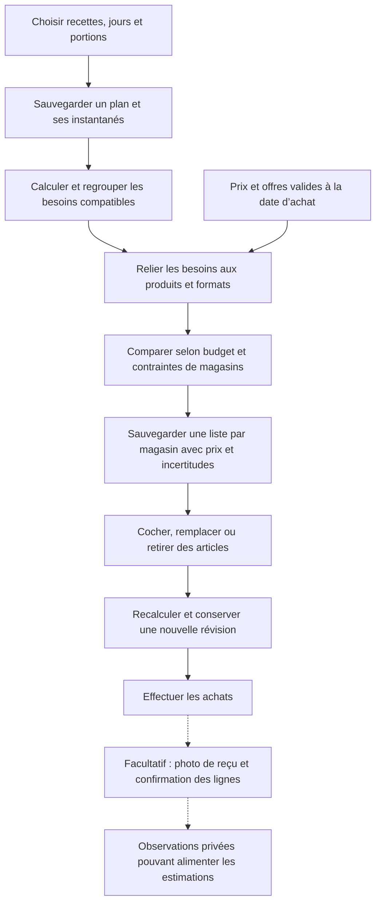

Les calculs de portions, conversions connues et prix seront effectués par le backend. Une unité incompatible ou un prix inconnu devra rester explicitement signalé. Une fourchette ne garantit pas le budget réel ; si certaines lignes ne sont pas estimables, la partie calculable devra être présentée comme un sous-total.

Les propositions IA devront être corrigées et confirmées avant sauvegarde. Les anciennes semaines devront conserver leurs recettes, portions et prix sous forme d’instantanés, même si les données courantes changent ensuite.

## 14. Un ordre de lecture pour explorer le code

Pour suivre un parcours sans lire tout le dépôt à la fois :

1. Ouvrir [App.tsx](mobile/App.tsx) pour repérer les écrans et la barrière de connexion.
2. Lire [AuthContext.tsx](mobile/context/AuthContext.tsx), puis [supabase.ts](mobile/services/supabase.ts), pour comprendre la session.
3. Suivre [RecipeListScreen.tsx](mobile/app/RecipeListScreen.tsx) vers [api.ts](mobile/services/api.ts) pour voir comment part une demande.
4. Repérer le routeur dans [main.py](backend/app/main.py), puis lire [recipes/router.py](backend/app/recipes/router.py).
5. Suivre l’opération dans [recipes/service.py](backend/app/recipes/service.py), avec [security.py](backend/app/security.py) pour l’identité.
6. Lire [recipes/models.py](backend/app/recipes/models.py) et [database.py](backend/app/database.py) pour comprendre la persistance.
7. Refaire le trajet avec [RecipeEditorScreen.tsx](mobile/app/RecipeEditorScreen.tsx) pour comprendre une écriture et l’envoi de photo.
8. Suivre [PromotionsScreen.tsx](mobile/app/PromotionsScreen.tsx) et [components/promos.ts](mobile/components/promos.ts) vers [common/public_router.py](backend/app/common/public_router.py) pour comprendre la lecture des offres.
9. Lire [CookWithPromosScreen.tsx](mobile/app/CookWithPromosScreen.tsx) pour retrouver le rapprochement entre recettes et promotions.
10. Suivre [import_circulars.py](backend/cli/import_circulars.py), puis les écrans Circulaires, pour comprendre le trajet des PDF jusqu’au téléphone.
11. Examiner ensuite les autres outils de catalogue et de reçus selon le besoin.

Pour une lecture de recette, le trajet à retrouver dans le code est : **écran → client HTTP → route FastAPI → service → PostgreSQL → réponse JSON → écran**. Pour la connexion et les fichiers images, les branches directes vers Auth et Storage complètent ce trajet.

*Dernière mise à jour : 27 octobre 2026*
