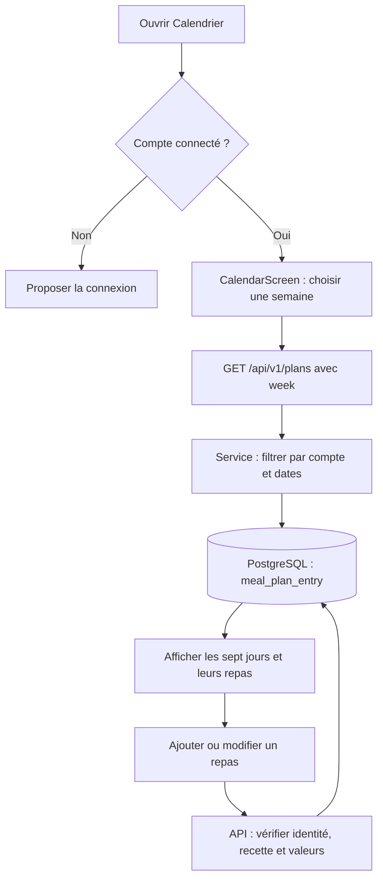
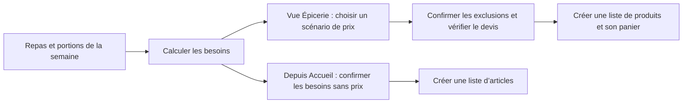

# Calendrier des repas

Le calendrier intégré depuis `main` le 1er novembre 2026 permet de conserver
les repas d’un compte dans PostgreSQL et de consulter une semaine à la fois.
La vue Épicerie calcule les besoins de cette semaine et permet de créer une
liste de produits indépendante. Le [guide des listes](SHOPPING_GUIDE.md) décrit
ce parcours. Les instantanés historiques des recettes et des prix ont été retirés
du périmètre ; le calendrier utilise les recettes courantes.

## Installation

Avec l’environnement Python activé et la connexion serveur configurée,
depuis la racine :

```bash
python -m alembic -c backend/alembic.ini upgrade head
```

La révision `0008_meal_plan`, après `0007_product_images`, crée
`public.meal_plan_entry`, ses contraintes,
les clés étrangères et les index. Le démarrage FastAPI n’applique pas les
migrations. Sans cette table, les accès au calendrier renvoient une erreur
503. Hamza a confirmé le 1er novembre 2026 l’application de `0008_meal_plan`
sur Supabase et le fonctionnement du calendrier sur iOS. Pour une nouvelle
installation, appliquer les migrations reste nécessaire.

La révision `0009_recipe_visibility` ajoute la visibilité des recettes.
La révision `0010_preserve_meals` conserve les repas après suppression
d’une recette grâce à une référence `ON DELETE SET NULL`. Elle a été appliquée
et contrôlée sur Supabase le 1er novembre, sans modifier les comptages existants.
`0015_permanent_public_recipes`, appliquée le 5 novembre, conserve aussi les
recettes publiques lorsque leur auteur supprime son compte. La tête actuelle du
dépôt et l’état des migrations sont décrits dans [MIGRATIONS.md](MIGRATIONS.md).

## Parcours mobile

Les visiteurs voient l’onglet Calendrier, mais une connexion est requise
avant le montage de `CalendarScreen`. Les comptes connectés peuvent :

- passer à la semaine précédente ou suivante et revenir à celle d’aujourd’hui ;
- ajouter un repas depuis les recettes accessibles ou les favoris, ou saisir une note ;
- choisir déjeuner, dîner, souper ou collation, ainsi que les portions ;
- ouvrir la recette associée depuis le menu d’un repas ;
- modifier les portions, déplacer, dupliquer ou supprimer un repas ;
- créer une entrée de restes à partir d’une recette.

`AddMealSheet` charge les dix premières recettes correspondant à la recherche
ou au filtre Favoris. `MealActionsSheet` propose les actions sur un repas.
Les repas marqués « restes » sont ignorés par le calcul des besoins d’épicerie
pour ne pas racheter les ingrédients d’un repas déjà préparé. Les notes libres
sont aussi ignorées et comptées séparément.



## Vue Épicerie et listes indépendantes

La période sélectionnée est transmise à `calendar-preview`. Le serveur ajuste
les ingrédients aux portions, regroupe les unités compatibles et signale les
recettes inaccessibles. `creation-prices` prépare ensuite les scénarios Le moins
cher, Maxi, Metro et Super C sans enregistrer de liste.

**Créer une liste de produits** reprend le scénario choisi. Les besoins sans
produit chiffrable et les repas indisponibles sont confirmés avant exclusion.
Le serveur valide les empreintes de l’aperçu et des prix puis enregistre la
liste active, ses produits et son panier dans une transaction. Elle est
immédiatement utilisable pour les achats et reste indépendante des modifications
ultérieures du calendrier.

Depuis Accueil, le parcours de la semaine permet aussi de confirmer des besoins
et de créer une liste d’articles sans produit ni montant. Ces commandes passent
par les routes des listes, pas par `/plans`.



## Routes et formats

Toutes les routes requièrent un jeton vérifié. Le propriétaire est déduit
côté serveur ; le client ne choisit jamais un identifiant d’utilisateur.

| Méthode et route | Rôle |
| --- | --- |
| `GET /api/v1/plans?week=2026-11-02` | Lire les entrées de la semaine contenant la date fournie ; le début renvoyé est un lundi |
| `POST /api/v1/plans/entries` | Ajouter un repas ; réponse 201 |
| `PATCH /api/v1/plans/entries/{id}` | Modifier les portions, la date et/ou le moment du repas |
| `DELETE /api/v1/plans/entries/{id}` | Supprimer son repas ; réponse 204 sans corps |

Exemple d’ajout :

```json
{
  "date": "2026-11-02",
  "meal": "souper",
  "recipe_id": "recipe_poulet_riz_brocoli",
  "servings": 2,
  "is_leftover": false
}
```

Donner exactement une recette (`recipe_id`) ou une note (`free_text`,
1 à 80 caractères après retrait des espaces). Les moments acceptés sont
`dejeuner`, `diner`, `souper`, `collation`. Les portions vont de 1 à 50.
Les restes exigent une recette. Une modification doit contenir au moins
une valeur non nulle parmi `servings`, `date` et `meal`.

Les lectures et mutations avec contenu répondent sous `item` et `meta`.
Une semaine contient `week_start` et `entries`. Chaque entrée contient son
UUID, la date, le moment, les portions, le marquage de restes, la référence
éventuelle à une recette, son nom et sa photo courants, ou une note.
Sans connexion : 401 ; recette inaccessible ou entrée d’autrui : 404 ;
corps invalide : 422 ; base ou schéma indisponible : 503.

## Conservation et limites

Une recette publique peut être ajoutée au calendrier d’un autre compte.
Sa publication est définitive : son auteur ne peut plus la rendre privée ni
la supprimer. Après suppression du compte auteur, `0015_permanent_public_recipes`
conserve la recette sans propriétaire ; les repas des autres comptes gardent
leur nom, photo et référence. Les repas du compte supprimé disparaissent.
Une référence devenue inaccessible par une intervention administrative reste
masquée : nom et photo sont nuls et le repas reste modifiable ou supprimable. Le mobile affiche « Recette indisponible » dans la carte et le menu. Il
conserve les portions, le déplacement et le retrait, mais ne propose plus
l’ouverture, la duplication ou de nouveaux restes. Le calendrier recharge
les accès au retour dans l’onglet et à chaque changement de semaine.

Les entrées sont privées par compte, avec RLS activée et accès métier via
FastAPI. La suppression du compte entraîne celle des repas par cascade,
en plus du profil, des recettes et des favoris.

Le calendrier utilise les données **courantes** des recettes : modifier le
nom ou la photo d’une recette change leur affichage dans les semaines déjà
planifiées. Supprimer une recette conserve les repas qui la référencent :
`recipe_id`, `recipe_name`, `recipe_image_url` et `free_text` sont alors nuls.
Les portions, la date, le créneau et le marquage de restes sont conservés.
Ce cas représente une recette supprimée ; les notes libres restent intactes.
Le POST refuse toujours une nouvelle entrée sans recette accessible ni note.
La suppression du compte retire ses propres repas, mais conserve ceux des
autres comptes. Ses recettes publiques restent accessibles sans auteur ; seules
les références aux recettes privées supprimées deviennent indisponibles.
Les repas effacés avant cette migration ne sont pas restaurés. Le modèle actuel ne capture pas les ingrédients, les prix ni
les étapes dans des révisions immuables. La consultation d’une ancienne
semaine n’est donc pas un historique figé. Cet historique est retiré du périmètre
depuis le cadrage du 17 novembre 2026.

Le calendrier ne gère pas de budget avancé. La date technique d’évaluation des
prix et les achats appartiennent aux parcours des listes. Leur raccordement au
calendrier est intégré ; l’historique par instantanés reste hors périmètre.

## Vérifications

Les tests backend couvrent les schémas et les dates ; les tests mobiles
vérifient que le calendrier reste protégé en mode visiteur. Le test de
suppression de compte inclut les repas des deux utilisateurs lorsqu’un
PostgreSQL local de test est disponible.

L’intégration avec le mode visiteur est vérifiée localement. Le 1er novembre
2026, Hamza a confirmé le calendrier sur Supabase et iOS. Cette confirmation
générale ne valide pas séparément chaque scénario d’erreur ou chaque action.
Les essais Android restent à effectuer. Compléter les scénarios détaillés de
persistance après réouverture, isolation de deux comptes, actions du menu,
changement de semaine, suppression d’une recette planifiée et erreurs réseau.

*Dernière mise à jour : 20 novembre 2026*
