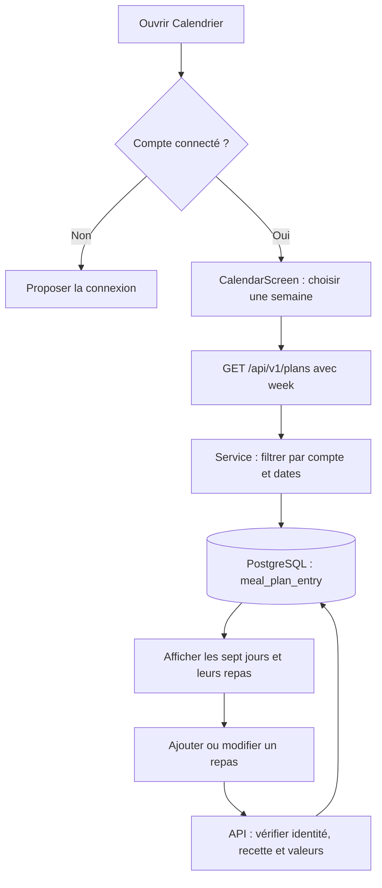

# Calendrier des repas

Le calendrier intégré depuis `main` le 1er novembre 2026 permet de conserver
les repas d’un compte dans PostgreSQL et de consulter une semaine à la fois.
Il complète les recettes et les comptes déjà présents. Il reste distinct du
futur moteur de listes d’épicerie et de l’historique par instantanés.

## Installation

Avec l’environnement Python activé et la connexion serveur configurée,
depuis la racine :

```bash
python -m alembic -c backend/alembic.ini upgrade head
```

La dernière révision est désormais `0008_meal_plan`, après
`0007_product_images`. Elle crée `public.meal_plan_entry`, ses contraintes,
les clés étrangères et les index. Le démarrage FastAPI n’applique pas les
migrations. Sans cette table, les accès au calendrier renvoient une erreur
503. Hamza a confirmé le 1er novembre 2026 l’application de `0008_meal_plan`
sur Supabase et le fonctionnement du calendrier sur iOS. Pour une nouvelle
installation, appliquer les migrations reste nécessaire.

## Parcours mobile

Les visiteurs voient l’onglet Calendrier, mais une connexion est requise
avant le montage de `CalendarScreen`. Les comptes connectés peuvent :

- passer à la semaine précédente ou suivante et revenir à celle d’aujourd’hui ;
- ajouter un repas depuis les recettes accessibles ou les favoris, ou saisir une note ;
- choisir déjeuner, dîner, souper ou collation, ainsi que les portions ;
- ouvrir la recette associée depuis le menu d’un repas ;
- modifier les portions, déplacer, dupliquer ou supprimer un repas ;
- créer une entrée de restes à partir d’une recette.

`AddMealSheet` charge les dix premières recettes correspondant à la recherche
ou au filtre Favoris. `MealActionsSheet` propose les actions sur un repas.
Le marquage « restes » est une information enregistrée ; aucun calcul de
coût ou de besoins d’épicerie n’est encore branché sur ce champ.



## Routes et formats

Toutes les routes requièrent un jeton vérifié. Le propriétaire est déduit
côté serveur ; le client ne choisit jamais un identifiant d’utilisateur.

| Méthode et route | Rôle |
| --- | --- |
| `GET /api/v1/plans?week=2026-11-02` | Lire les entrées de la semaine contenant la date fournie ; le début renvoyé est un lundi |
| `POST /api/v1/plans/entries` | Ajouter un repas ; réponse 201 |
| `PATCH /api/v1/plans/entries/{id}` | Modifier les portions, la date et/ou le moment du repas |
| `DELETE /api/v1/plans/entries/{id}` | Supprimer son repas ; réponse 204 sans corps |

Exemple d’ajout :

```json
{
  "date": "2026-11-02",
  "meal": "souper",
  "recipe_id": "recipe_poulet_riz_brocoli",
  "servings": 2,
  "is_leftover": false
}
```

Donner exactement une recette (`recipe_id`) ou une note (`free_text`,
1 à 80 caractères après retrait des espaces). Les moments acceptés sont
`dejeuner`, `diner`, `souper`, `collation`. Les portions vont de 1 à 50.
Les restes exigent une recette. Une modification doit contenir au moins
une valeur non nulle parmi `servings`, `date` et `meal`.

Les lectures et mutations avec contenu répondent sous `item` et `meta`.
Une semaine contient `week_start` et `entries`. Chaque entrée contient son
UUID, la date, le moment, les portions, le marquage de restes, la référence
éventuelle à une recette, son nom et sa photo courants, ou une note.
Sans connexion : 401 ; recette inaccessible ou entrée d’autrui : 404 ;
corps invalide : 422 ; base ou schéma indisponible : 503.

## Conservation et limites

Les entrées sont privées par compte, avec RLS activée et accès métier via
FastAPI. La suppression du compte entraîne celle des repas par cascade,
en plus du profil, des recettes et des favoris.

Le calendrier utilise les données **courantes** des recettes : modifier le
nom ou la photo d’une recette change leur affichage dans les semaines déjà
planifiées. Supprimer une recette supprime aussi les entrées qui la
référencent. Le modèle actuel ne capture pas les ingrédients, les prix ni
les étapes dans des révisions immuables. La consultation d’une ancienne
semaine n’est donc pas encore l’historique stable demandé dans le cadrage.

Le calendrier n’enregistre pas encore de date d’achat ou de contraintes de
budget, et ne génère aucune liste d’épicerie. Les instantanés, les révisions
et le raccordement au calcul des achats restent à développer.

## Vérifications

Les tests backend couvrent les schémas et les dates ; les tests mobiles
vérifient que le calendrier reste protégé en mode visiteur. Le test de
suppression de compte inclut les repas des deux utilisateurs lorsqu’un
PostgreSQL local de test est disponible.

L’intégration avec le mode visiteur est vérifiée localement. Le 1er novembre
2026, Hamza a confirmé le calendrier sur Supabase et iOS. Cette confirmation
générale ne valide pas séparément chaque scénario d’erreur ou chaque action.
Les essais Android restent à effectuer. Compléter les scénarios détaillés de
persistance après réouverture, isolation de deux comptes, actions du menu,
changement de semaine, suppression d’une recette planifiée et erreurs réseau.

*Dernière mise à jour : 1er novembre 2026*
